# joyclub-opa-scan

Implementiert einen Schutz vor sabbernden alten Opas in JOYclub.

Ein Tampermonkey-Userscript für [joyclub.de](https://www.joyclub.de). Es findet Mitglieder, die nach einstellbaren Regeln zu alt sind (bzw. Paare mit großem Altersunterschied), schreibt ihnen eine Profilnotiz und setzt sie auf die JOYclub-Ignorierliste – bei Interaktionen („Mögen mich“), Profilbesuchern, auf Partys, in Gruppen und in der Mitgliedersuche.

Stand: Version 1.79 – Änderungen siehe [changelog.txt](changelog.txt)

---

## Installation und Updates

1. [Tampermonkey](https://www.tampermonkey.net/) im Browser installieren.
2. Diesen Link öffnen und auf „Installieren“ klicken:
   https://raw.githubusercontent.com/Schimmelreiter/joyclub-opa-scan/main/joyclub-mitglieder-alter-blockieren.user.js
3. Updates holt Tampermonkey automatisch (`@updateURL`), standardmäßig einmal täglich – sofort über *Dashboard → Nach Updates suchen*.

Alle gespeicherten Daten (Protokoll, Whitelist, Scan-Stände …) liegen im Tampermonkey-Speicher und bleiben bei Updates erhalten.

> **Wichtig ab 1.74: Nach der Installation ist alles ausgeschaltet.** Für jede Gruppe (Männer, Frauen, Paare) gibt es die Schalter **„Visuelle Einstufung“** und **„Ignorieren aktiv“** – beide stehen zunächst auf *aus*, auch nach einem Update. Einschalten auf der Seite **Opa-Schutz** (Hamburger-Menü → *Opa-Schutz*, siehe [Einstellungen](#einstellungen-seite-opa-schutz)). Solange „Ignorieren aktiv“ aus ist, sperrt das Skript in dieser Gruppe niemanden.

**Speicher-Umbau (einmalig mit 1.74):** Beim ersten Aufruf nach dem Update fragt das Skript, ob es vorher eine Sicherung aller Daten herunterladen soll, und baut den Speicher dann auf einen Eintrag je Mitglied um. Die alten Daten werden erst gelöscht, wenn jeder Eintrag geprüft ist.

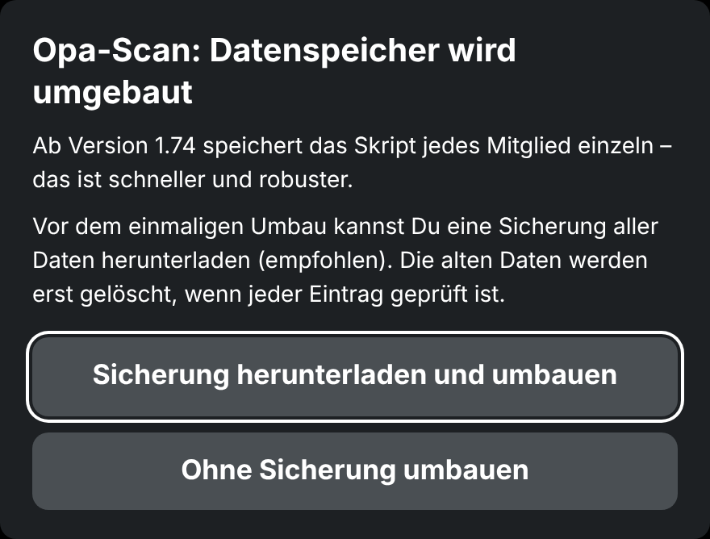

---

## Regeln: Wer wird ignoriert?

Die Mitglieder werden in drei **Gruppen** eingeteilt: **Männer**, **Frauen** und **Paare**. Jede Gruppe hat je **Quelle** (Interaktionen, Profilbesucher, Partygäste, Gruppen, Mitgliedersuche) eigene Altersgrenzen:

- **Visuelle Einstufung** in drei Stufen (zwei Grenzen): bis zur ersten Grenze Stufe 1 (grün), bis zur zweiten Stufe 2 (orange), darüber Stufe 3 (rot). Die Stufen bestimmen Farben, Bezeichnungen (z. B. Mann/Mann/Opa), Reiter der Gästeliste und den AWO-Faktor.
- **Ignorieren ab** einem Alter (eine Grenze).

| Gruppe | Bezeichnungen (Einzahl) | Visuell bis | Ignorieren ab | Profiltypen (Standard) |
|---|---|---|---|---|
| Männer | Mann / Mann / Opa | 29 / 49 | 50 (Suche: 100) | Mann, Transmann, Transvestit, Non-binary, Männer-Paar |
| Frauen | Frau / Frau / Oma | 25 / 49 | 50 (Suche: 100) | Frau |
| Paare | Pärchen / Paar / Geronto-Paar | 39 / 59 | 60 (Suche: 100) | Paar |

- **Paare:** Frau und Mann haben eigene Werte; ein Paar wird erst ignoriert, wenn **beide** ihre Schwelle erreichen (Geronto-Paar). Angezeigt wird die Stufe der jüngeren Person.
- **Sugar Daddy** (Mann mindestens 18 Jahre älter) und **Sugar Mom** (Frau mindestens 18 Jahre älter) gehören zu den Paaren, jeweils mit eigenem Schalter und Abstand. Trifft Geronto-Paar und Sugar Daddy zu, gilt Sugar Daddy; Geronto-Paar und Sugar Mom → Geronto-Paar.
- **Männer-/Frauen-Paare** in der Gruppe Paare nutzen die Werte des Mannes bzw. der Frau mit dem höheren Alter; großer Altersunterschied → Sugar Daddy bzw. Sugar Mom. In den Gruppen Männer/Frauen zählt bei Paar-Typen das höhere Alter.
- **Profiltypen:** Mann, Frau und Paar sind fest zugeordnet. Trans* und Non-binary können zu Männern oder Frauen, Männer-Paare zu Männern oder Paaren, Frauen-Paare zu Frauen oder Paaren, Trans-Paare zu allen drei. Jeder Typ gehört zu höchstens einer Gruppe; **nicht zugeordnete Typen werden nicht bearbeitet**. Unbekannte Typen, die das Skript findet, erscheinen in allen Gruppen (nicht angehakt).
- **Whitelist** (`WHITELIST` + gelernte Einträge): wird nie ignoriert.
- **Schalter je Gruppe** (Standard: aus): *Visuelle Einstufung* (Farben, Umbenennen, eigene Reiter) und *Ignorieren aktiv* (rotes X, Notiz, Sperre).

Vor dem Ignorieren schreibt das Skript eine Profilnotiz mit der Bezeichnung der Stufe 3, z. B.
`Opa (Party) ignoriert am 21.10.2026 um 12:00`, `Oma (Likes) ignoriert am …`, `Geronto-Paar (Gruppen) ignoriert am …`, `Sugar Daddy (Party) ignoriert am …` oder `Sugar Mom (Suche) ignoriert am …`.
Die Quelle in Klammern sagt, wo das Mitglied gefunden wurde. Ältere Notizen (z. B. „Alter Sack … geblockt am …“) und früher verwendete Bezeichnungen werden weiter erkannt; „Synchronisieren – Script hat Vorrang“ mit Notizen gleicht umbenannte Notizen an.

**Eigenes Profil:** Ist das eigene Profil ein *Mann*, heißt alles „Oma“ statt „Opa“ (Oma-Scan, Oma-Schutz, Reiter „Oma-Liste“, Badge „blockierte Omas“, Oma-Symbol). Bei allen anderen eigenen Profiltypen bleibt es bei „Opa“.

**Werte beim bloßen Ansehen:** Gästeliste → Partygäste, Profilbesuche → Profilbesucher, „Mögen mich“ → Interaktionen, Gruppen-Mitgliederliste → Gruppen, Suche → Mitgliedersuche, Profil/sonst → höchste Quelle, in der das Mitglied gesehen wurde (sonst die niedrigste).

Ignoriert wird über das Profil (Notiz speichern → *Profiloptionen → Profil ignorieren → Ignorieren*) bzw. im Hintergrund über die Ignorierliste `/ignore/`.

`DRY_RUN: true` (auf der Seite „Opa-Schutz“: *Testlauf*) schaltet einen Testmodus ein, in dem nichts verändert wird.

---

## Einstieg: Menü und Titelzeile

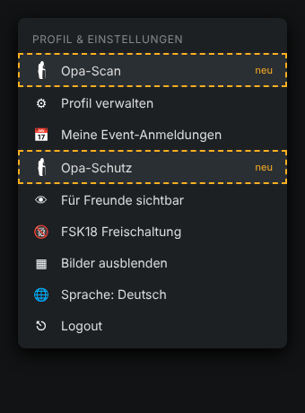

- **Hamburger-Menü**, Block „Profil & Einstellungen“: **Opa-Scan** (Opa-Lupe) vor „Profil verwalten“ startet alle Scans nacheinander; **Opa-Schutz** (Opa) vor dem Sichtbarkeits-Eintrag („Für Freunde sichtbar“ o. ä. – gefunden über das Linkziel `/edit/invisible/`) öffnet die Einstellungen.
- **Titelzeile:** rechts neben „Kontakte“ ein Opa-Button mit Status darunter (*aktiv*, *Testlauf*, *Scan läuft* oder ab 95 % Füllstand die Zahl der Sperren, z. B. *987/1000*); Klick öffnet die Einstellungen. Wie „Kontakte“ auf kleinen Bildschirmen ausgeblendet.
- **Profilverwaltung:** „Opa-Schutz“ ist erster Punkt unter „Sicherheit & Datenschutz“ in der linken Spalte.

---

## Einstellungen: Seite „Opa-Schutz“

Adresse: `https://www.joyclub.de/edit/account/#opa-schutz` – aufgebaut wie JOYclubs Seite „Account“.

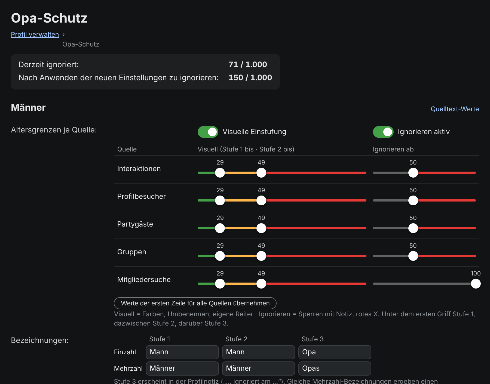

**Kopfzeile:** „Derzeit ignoriert: X / Limit“ und „Nach Anwenden der neuen Einstellungen zu ignorieren: N / Limit“ – live berechnet aus dem Gedächtnis aller bekannten Konten, während man Regler verschiebt. Orange bei weniger als 50 freien Plätzen, rot über dem Limit; ein „+“ heißt, dass es zusätzlich unklare Mitglieder gibt (z. B. Paare mit nur einer Altersangabe).

**Je Gruppe (Männer, Frauen, Paare)**, in dieser Reihenfolge:
1. **Schalter** als Kippschalter: *Visuelle Einstufung* über der Spalte der visuellen Regler, *Ignorieren aktiv* über der Spalte „Ignorieren ab“.
2. **Altersgrenzen je Quelle:** ein Regler mit zwei Griffen (Stufe 1 bis · Stufe 2 bis) und ein Regler mit einem Griff (Ignorieren ab), Bereich 18–100; Button **„Werte der ersten Zeile für alle Quellen übernehmen“**. Bei Paaren je Quelle eine Zeile für die Frau und eine für den Mann; ohne Haken bei **Getrenntes Alter** verschieben sich beide Balken gemeinsam. Dazu **Sugar Daddy** und **Sugar Mom** mit Schalter und Altersabstand.
3. **Bezeichnungen** der drei Stufen (Einzahl/Mehrzahl). Gleiche Mehrzahl-Bezeichnungen ergeben einen gemeinsamen Reiter.
4. **Profiltypen** (Haken; ein Haken entfernt den Typ aus den anderen Gruppen).

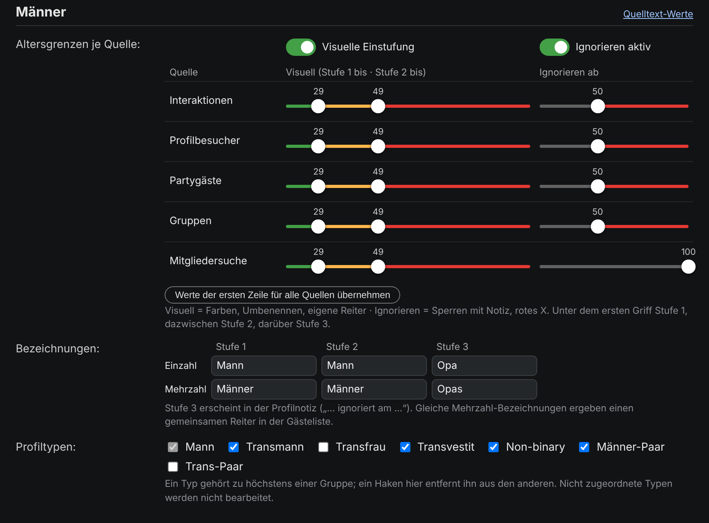

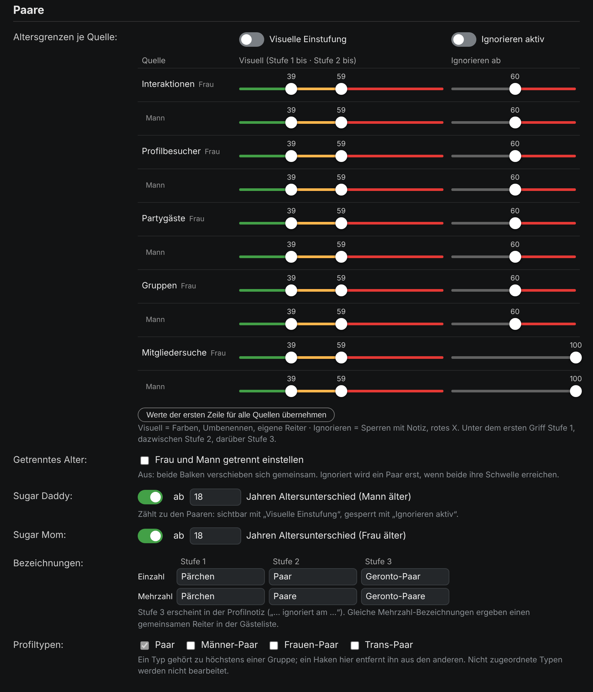

Der Link **Quelltext-Werte** neben der Überschrift setzt eine Gruppe auf die Werte aus dem Quelltext zurück.

**Whitelist** (Zusammenfassung + Button **Whitelist bearbeiten**) und **AWO-Faktor** (siehe [AWO-Faktor](#awo-faktor)):

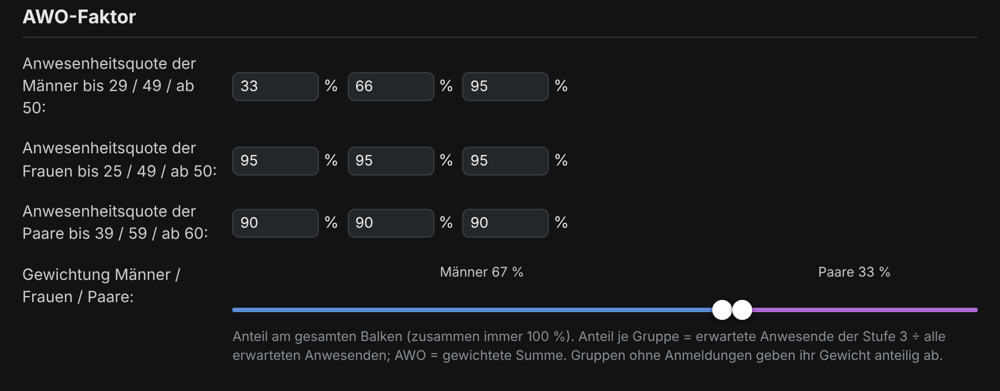

- **Experten-Einstellungen** (beim Öffnen immer zugeklappt): **Ignorierliste** mit **Rangfolge der Quellen** (▲▼, Erklärung beim Darüberfahren) und **Limit** (rot), **API-Rekorder**, zuletzt **Betrieb** (Debug-Ausgaben, Testlauf, Obergrenze für den ersten Scan von Profilbesuchern/Interaktionen). Die Profilnotiz wird immer vor dem Ignorieren geschrieben; ohne gespeicherte Notiz wird nicht ignoriert (nicht abschaltbar).

  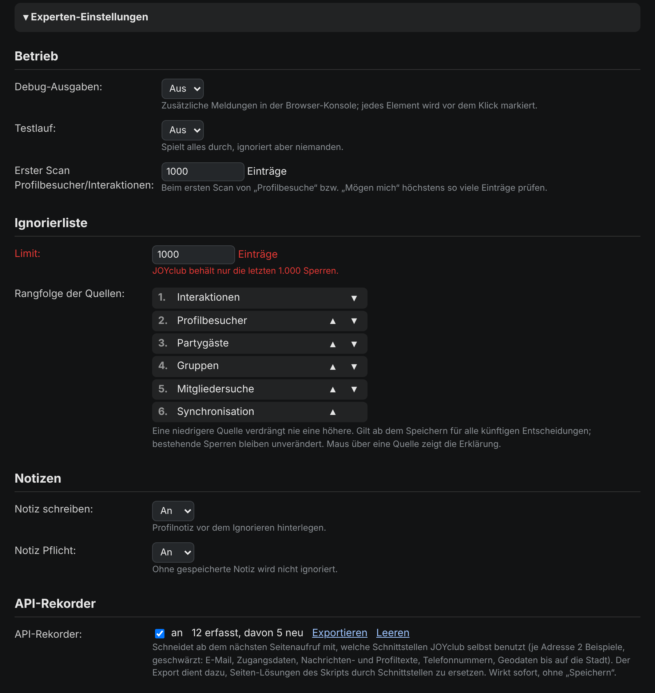
- **Speichern / Abbrechen.** Wer die Seite mit ungespeicherten Änderungen verlässt, wird gefragt (*Speichern und verlassen / Verwerfen und verlassen / Abbrechen*); beim Schließen oder Neuladen des Tabs kommt die Standardabfrage des Browsers.

  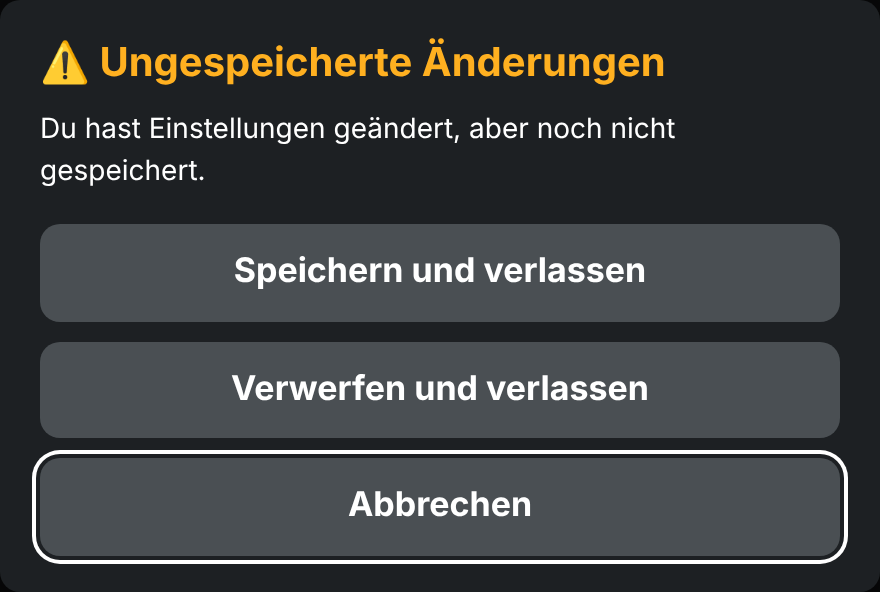

### Speichern von Regeländerungen

Ändern sich Regeln, die das Ignorieren betreffen (Schalter „Ignorieren aktiv“, Schwellen, Profiltypen, Sugar Daddy/Mom, Stufe-3-Bezeichnungen, Limit), zeigt **Speichern** ein Popup mit den Auswirkungen: derzeit ignoriert, nach Anwenden, fallen weg, kommen dazu, Notizen weichen ab, unklar.

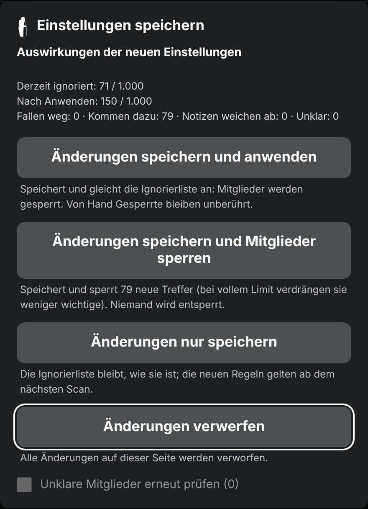

| Button | Wirkung |
|---|---|
| Änderungen speichern und anwenden | speichert und gleicht die Ignorierliste an: Mitglieder werden gesperrt oder entsperrt, Notizen angepasst |
| … und Mitglieder entsperren | nur, wenn welche wegfallen: speichert und entsperrt sie |
| … und Mitglieder sperren | nur, wenn welche dazukommen: speichert und sperrt sie (bei vollem Limit verdrängen sie weniger wichtige) |
| Änderungen nur speichern | Ignorierliste bleibt; neue Regeln gelten ab dem nächsten Scan |
| Änderungen verwerfen (vorausgewählt) | verwirft alle Änderungen der Seite |

Der Haken **„Unklare Mitglieder erneut prüfen“** ruft deren Profile im Hintergrund auf (mit Sichtbarkeits-Warnung). Wird das Limit verringert, entsperrt das Skript in der Verdrängungs-Reihenfolge. Danach prüft es die JOYclub-Liste gegen die erwarteten Einträge und repariert sie. Von Hand Gesperrte werden nie angefasst. Nach jeder Regeländerung beginnen die Scans von vorn (Partys, Gruppen, Profilbesucher/„Mögen mich“).

**Speicherung:** Die Einstellungen liegen im Tampermonkey-Speicher, zusammen mit dem zuletzt gesehenen Wert aus dem Quelltext. Ändert man einen Wert im Quelltext, gilt ab dann dieser; solange der Quelltext-Wert gleich bleibt, gilt der gespeicherte. Abweichungen vom Quelltext sind mit „°“ markiert, der Link **Quelltext-Wert** setzt zurück. Betroffen: `DRY_RUN`, `DEBUG`, `IGNORE_LIMIT`, `MYJOY_FIRST_MAX`, `GROUPS`, `AWO`, `WHITELIST`, `WRITE_NOTE`, `NOTE_REQUIRED`, `SOURCE_RANK`. Die Altersgrenzen bis 1.73 (`MAX_AGE`, `WARN_AGE`, `COUPLE_BOTH_MIN_AGE`, `COUPLE_AGE_GAP`, `ONLY_TYPES`) werden beim Update einmalig in die neue Tabelle übernommen; die Schalter bleiben dabei aus.

---

## Whitelist

**Bearbeiten** im Popup „Whitelist bearbeiten“ (Seite „Opa-Schutz“):

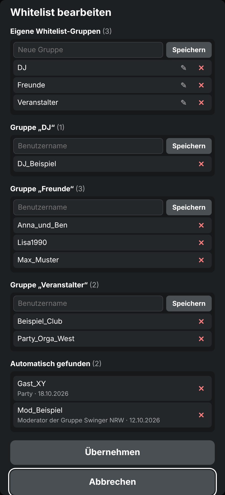

- Oben die Liste **Eigene Whitelist-Gruppen** (alphabetisch): Eingabefeld + „Speichern“ für neue Gruppen, ✎ zum Umbenennen, ✕ zum Löschen. Eine Gruppe darf leer sein; ein schon vorhandener Name wird abgelehnt.
- Darunter je Gruppe eine eigene Liste ihrer Mitglieder (alphabetisch) mit Eingabefeld + „Speichern“ und ✕. Jedes Mitglied darf nur in **einer** Gruppe stehen („Steht schon in …“).
- Löschen einer Gruppe fragt nach, weil auch alle ihre Mitglieder gelöscht werden (vorausgewählt: Abbrechen):

  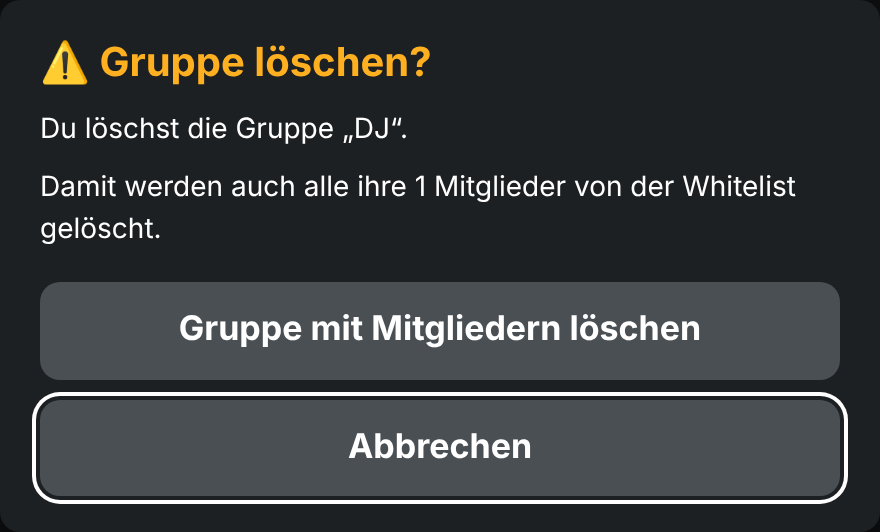
- Ganz unten **Automatisch gefunden** mit Grund und Datum, ✕ entfernt einen Eintrag. Wer in eine eigene Gruppe eingetragen wird, verschwindet dort; automatisch wird niemand aufgenommen, der schon auf der eigenen Whitelist steht.
- „Übernehmen“ überträgt die Änderungen auf die Seite, dauerhaft gespeichert wird erst mit „Speichern“.

Inhalt:

- **Feste Einträge** in `CONFIG.WHITELIST` bzw. auf der Seite „Opa-Schutz“, gruppiert nach Grund (Veranstalter, DJ, Party, Freundeslisten, manuell).
- **Automatisch ergänzt:**
  - Moderatoren der gescannten Gruppen (fallen bei Verlust des Moderatorenstatus wieder heraus),
  - Veranstalter gescannter Partys (dauerhaft, werden ggf. entsperrt),
  - VIP-Gäste, die im Veranstaltungstext verlinkt sind,
  - Mitglieder, die über „Nicht mehr ignorieren“ entsperrt wurden,
  - **Freunde** (`/kontakte/friendship.html`, Grund „Freund“) und Kontakte mit **„Persönlich bekannt“** (`/kontakte/`, Grund „persönlich bekannt“): höchstens einmal täglich im Hintergrund gelesen, sofort beim Öffnen dieser Seiten und vor dem Ignorieren, wenn die Liste älter als 24 Stunden ist. Wer dort fehlt, fällt erst nach 30 Tagen Schonfrist heraus (könnte auch nur unsichtbar geworden sein). Vom Opa-Schutz Ignorierte, die auf diese Liste kommen, werden entsperrt (von Hand Ignorierte nie); das Protokoll nennt sie.
- Whitelist-Einträge bekommen eine eigene Profilnotiz, z. B. `Whitelist: Party "…" am …`, `Whitelist: Veranstalter von "…"`, `Whitelist: Profilbesucher am …` oder `Whitelist: Interaktion am …`.
- Profil-Links der Whitelist-Mitglieder werden gelernt, sobald sie irgendwo auftauchen.

---

## Opa-Scan aus dem Menü (alle Scans)

**Opa-Scan** im Hamburger-Menü öffnet ein Popup, das erklärt, was passiert, und alle eingebauten Scans mit Checkbox auflistet – in der aktuellen Rangfolge der Quellen, die Mitgliedersuche wegen ihrer Dauer immer zuletzt. Für Partys gibt es nur einen Eintrag (beide Event-Übersichten zeigen dieselben Partys). Die Auswahl wird gemerkt; anfangs ist alles ausgewählt außer der Mitgliedersuche. Geprüft werden nur Profile, die für die aktuellen Einstellungen relevant sind (z. B. Frauen nur, wenn bei den Frauen „Ignorieren aktiv“ an ist).

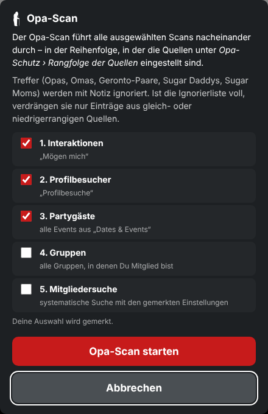

Die Scans laufen nacheinander im Hintergrund auf der aktuellen Seite. Oben der Gesamtfortschritt („Scan 2/4: Profilbesucher“), darunter der Fortschritt des laufenden Scans:

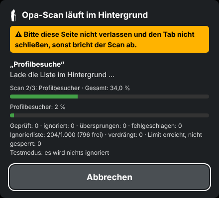

Am Ende eine Zusammenfassung je Scan: geprüft, neu ignoriert, verdrängt, „Limit erreicht, nicht gesperrt“.

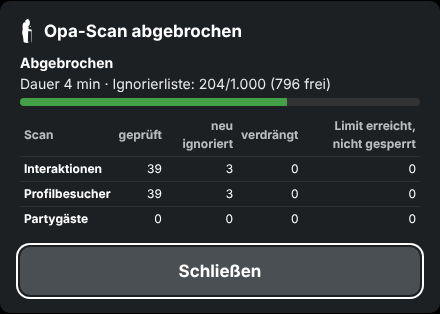

---

## Profilbesucher und Interaktionen

Seiten `/my_joy/visitors/` (Reiter „Profilbesuche“, Quelle **Profilbesucher**), `/my_joy/voting/top/` („Mögen mich“, Quelle **Interaktionen**) und `/clubmail/` (ClubMail-Übersicht, ebenfalls Quelle **Interaktionen**). JOYclub wechselt die Reiter ohne Neuladen – das Skript folgt der Adresse.

- **ClubMail:** Jede Unterhaltung mit einem Mitglied zählt als Interaktion (Schwellen der Zeile „Interaktionen“, Datum der letzten Nachricht). Nachrichteninhalte werden weder gelesen noch gespeichert. Partys, Clubs, JOY-Team, gelöschte Konten und eigene Konten (eingeloggtes und das Zweitkonto aus „Partys synchronisieren“) zählen nicht; jedes Mitglied zählt nur einmal. Die Notiz nennt „ClubMail“ als Quelle. Der Opa-Scan aus dem Menü prüft die ClubMail zusammen mit „Mögen mich“.

- **Beim Ansehen:** Karten werden eingefärbt wie Gästelisten (rotes X bei Ignorierten, Klick → Popup „Du ignorierst …“), auch nachgeladene. Für bekannte Mitglieder wird das Datum am Abzeichen als „zuletzt gesehen“ gespeichert (siehe Quellen).
- **Datum:** „Heute“, „Gestern“, Wochentag (der letzte Tag dieses Namens, 2–6 Tage zurück) oder `TT.MM.` (laufendes Jahr, läge es in der Zukunft: Vorjahr).
- **Scan:** Button **Opa-Scan starten** im Kopfbereich (in der ClubMail waagerecht mittig zwischen der Überschrift „ClubMail“ und dem Filter-Knopf, bei wenig Platz nur als Icon) → Popup → „Jetzt scannen …“:

  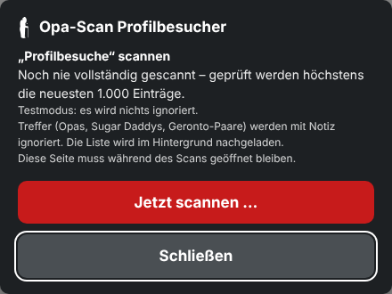
- Nachgeladen wird im Hintergrund, bis das Datum vor dem Tag des letzten vollständigen Scans dieses Reiters liegt; beim ersten Scan höchstens `MYJOY_FIRST_MAX` (1000) Einträge. Paare mit zwei Altersangaben werden direkt entschieden, Paare mit einer auf dem Profil geprüft; Karten ohne Geschlecht (Clubs, Veranstalter) werden übersprungen. Kein automatischer Start.

---

## Sichtbarkeit (Unsichtbar-Modus)

Profilaufrufe hinterlassen Besuche. Das Skript liest den Status unter dem Profilnamen (leer = sichtbar, „Für Freunde sichtbar“, „Unsichtbar eingeloggt“; „Für Freunde sichtbar“ zählt als unsichtbar).

- Vor **jedem** Vorgang mit Profilaufrufen (alle Scans, Sync mit Profilaufrufen, „Nicht mehr ignorieren“) warnt es bei sichtbarem Login:

  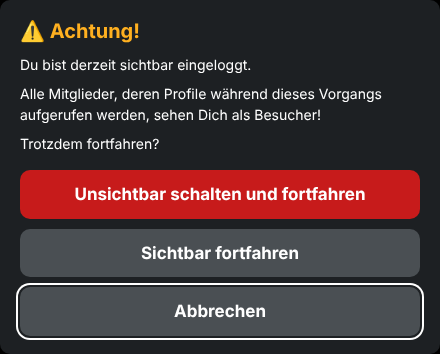

  *Unsichtbar schalten und fortfahren* setzt den Status auf „Unsichtbar“ und wartet 15 Sekunden; *Sichtbar fortfahren* lässt alles, wie es ist; vorausgewählt ist *Abbrechen*. Nach dem Vorgang bleibt man unsichtbar.
- Wurde unsichtbar gestartet und schaltet sich jemand während des Vorgangs sichtbar (z. B. in der App), stellt das Skript beim nächsten Seiten- oder Frame-Aufruf den vorherigen Status wieder her und wartet 15 Sekunden.
- Wer auf `/edit/invisible/` „Sichtbar“ speichert, während Vorgänge laufen, wird gefragt:

  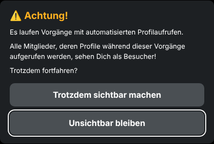

  *Trotzdem sichtbar machen* speichert und behandelt die laufenden Vorgänge wie mit „Sichtbar fortfahren“ gestartet; *Unsichtbar bleiben* (vorausgewählt) bricht das Speichern ab.

---

## Gruppen: Opa-Scan

Auf der Gruppenübersicht `/groups/` steht der Button **„Opa-Scan starten“** neben dem Regionen-Filter.

- Liest die Mitgliederlisten aller eigenen Gruppen im Hintergrund (mit Geschlechterfilter und allen Seiten).
- Ignoriert Treffer nach den Regeln, Moderatoren kommen auf die Whitelist.
- Reihenfolge: am längsten nicht bearbeitete Gruppe zuerst.
- Jede Gruppenkarte zeigt ein Badge mit dem Datum des letzten vollständigen Scans.
- In Mitgliederlisten wird der Profiltyp bei eingeschalteter visueller Einstufung zur Bezeichnung der Stufe (z. B. Mann / Opa, Frau / Oma; Opa- bzw. Oma-Symbol in Stufe 3).

---

## Partys: Opa-Scan

### Start

Zwei Übersichtsseiten der eigenen Eventanmeldungen haben einen Button **„Opa-Scan starten“**:

- `/profile/appointments/<eigene ID>…html` – neben der Überschrift „Eventanmeldungen“
- `/dates_partys/events/registrations/` („Dates & Events“) – links neben „Vergangene Events“ (mit etwas Abstand); das Skript lädt vorher alle per Scrollen nachladbaren Partys

### Ablauf (im Hintergrund)

Ab 1.93 holt der Hintergrund-Frame die Gästeliste über JOYclubs Schnittstelle (`guests_scroll_data`, 40 Anmeldungen je Abruf) und meldet den Fortschritt laufend; Scrollen nur noch als Rückfall. Kommt 90 Sekunden lang kein Lebenszeichen aus dem Frame, gilt die Party als Fehlschlag und der Scan geht zur nächsten. Bei eingeschaltetem API-Rekorder steht jeder Schritt (Seite geladen, Sonderseite erkannt, Gästeliste n, fertig/Fehler, Pausen) als „ablauf“ in der Zeitleiste.

Ein Klick auf „Opa-Scan starten“ öffnet sofort das Scan-Popup (keine Browser-Meldungen): Es sammelt die Partys, nennt ihre Zahl bzw. den Grund, warum gerade kein Scan möglich ist, und startet erst mit **„Jetzt scannen …“**. Danach wird daraus „Abbrechen“.

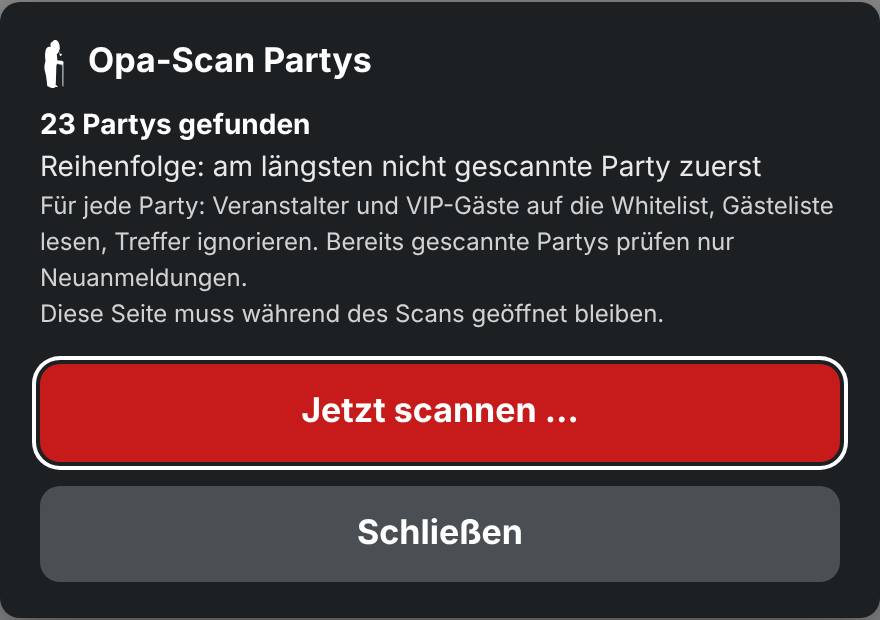

Der Scan läuft in unsichtbaren Frames; die Übersichtsseite bleibt offen, das Popup zeigt Fortschritt und Statistik. Für jede Party:

1. Veranstalter dauerhaft auf die Whitelist (und ggf. entsperren).
2. VIP-Gäste aus dem Veranstaltungstext auf die Whitelist.
3. Gästeliste „Alle“ vollständig lesen.
4. Jede Anmeldung einordnen:
   - nur Gruppen mit „Ignorieren aktiv“ werden geprüft,
   - Paare werden direkt anhand der beiden Altersangaben entschieden (mit nur einer Angabe: Profil prüfen),
   - Einzelpersonen werden nur auf dem Profil geprüft, wenn schon das Anmeldealter die Schwelle der Gruppe erreicht,
   - externe und anonyme Anmeldungen, Shops sowie Club-/Veranstalter-Profile (`business_profile`) werden übersprungen.
5. Profile im Hintergrund prüfen (Ergebnis wird 1 Jahr zwischengespeichert) und Treffer ignorieren.

**Effizienz:**
- Erneute Scans prüfen nur Neuanmeldungen seit dem letzten Scan; ändern sich die Regeln, wird automatisch wieder vollständig gescannt.
- Reihenfolge: am längsten nicht gescannte Party zuerst – die nächste anstehende Party wird vorgezogen, wenn alle schon einmal gescannt wurden und der älteste Scan jünger ist als die Zeit bis zu dieser Party.
- Fehlschläge werden mit Party, Profil-Link, Schritt und Meldung gespeichert und sind exportierbar.

### AWO-Faktor

Ein Maß für den Anteil alter Gäste einer Party (Stufen nach den visuellen Werten der Quelle „Partygäste“):

- Je Gruppe und Stufe eine **Anwesenheitsquote** (Standard: Männer 33 / 66 / 95 %, Frauen 95 / 95 / 95 %, Paare 90 / 90 / 90 %): So viele der Angemeldeten erscheinen voraussichtlich.
- **Anteil je Gruppe** = erwartete Anwesende der Stufe 3 ÷ alle erwarteten Anwesenden der Gruppe (Sugar Daddys/Moms zählen als Stufe 3).
- **AWO** = gewichtete Summe der Anteile, Gewichte Standard Männer 67 / Frauen 0 / Paare 33 %. Hat eine Gruppe keine Anmeldungen, wird ihr Gewicht anteilig auf die anderen verteilt.
- Einstellbar auf der Seite „Opa-Schutz“ im Abschnitt **AWO-Faktor**: drei ganzzahlige %-Felder je Gruppe (die Grenzen in der Beschriftung folgen den Reglern) und ein Gewichtungs-Regler mit zwei Griffen (bei Frauen 0 % liegen sie bündig nebeneinander; Tooltips „Männer = xx % / Frauen = yy %“ bzw. „Frauen = yy % / Paare = zz %“). Die Gewichte ergeben immer 100 %.
- Farben: unter 10 % hellgrün, unter 25 % grün, unter 35 % orange, ab 35 % rot

Angezeigt wird er
- auf der Event-Seite (rechts in der Reiterleiste),
- auf den Karten der eigenen Eventanmeldungen und im Slider „Dates & Events“ der **Profilseiten**: oben rechts das Datum des letzten Scans, darunter „AWO xx %“. Auf dem eigenen Profil zeigen noch nicht gescannte Partys die Platzhalter „--.--.----“ und „AWO –“; auf fremden Profilen erscheint bei ungescannten Partys nichts,
- auf „Dates & Events“ hinter „… Personen angemeldet.“ samt Zeitpunkt des letzten Scans, ungescannt „AWO – (--.--.----)“.

### Event-Seite

- Die Gästeliste wird im Hintergrund in zusätzliche Reiter aufgeteilt – je Gruppe mit eingeschalteter visueller Einstufung nach den Mehrzahl-Bezeichnungen der Stufen, z. B. **Männer → Männer / Opas**, **Frauen → Frauen / Omas**, **Paare → Pärchen / Paare / Geronto-Paare** (gleiche Bezeichnungen = ein Reiter). Trans*/Non-binary-Anmeldungen wandern in die zugeordnete Gruppe, Paare (auch Männer-/Frauen-Paare) bleiben bei den Paaren. Die Originalliste bleibt sichtbar, bis die Reiter fertig sind.
  - Leere Reiter entstehen nicht. Hat eine Gruppe gar keine Anmeldungen, bleibt ihr Original-Reiter von JOYclub stehen.
  - Ein Original-Reiter wird nur ausgeblendet, wenn alle seine Anmeldungen in neue Reiter umgezogen sind.
  - Anmeldungen, deren zugeordnete Gruppe keine visuelle Einstufung hat (z. B. eine den Frauen zugeordnete Transfrau aus „Männer“), kommen in den Original-Reiter dieser Gruppe; dessen Zahl wird angepasst, fehlt er, wird er angelegt.
- Gäste werden nach Anmeldealter eingefärbt; ignorierte Mitglieder bekommen ein rotes X.
- Klick auf ein ignoriertes Mitglied öffnet ein Popup *„Du ignorierst …“* mit Grund (Profilnotiz) und den Buttons **Trotzdem öffnen**, **Nicht mehr ignorieren** (entsperrt und setzt auf die Whitelist) und **Abbrechen**:

  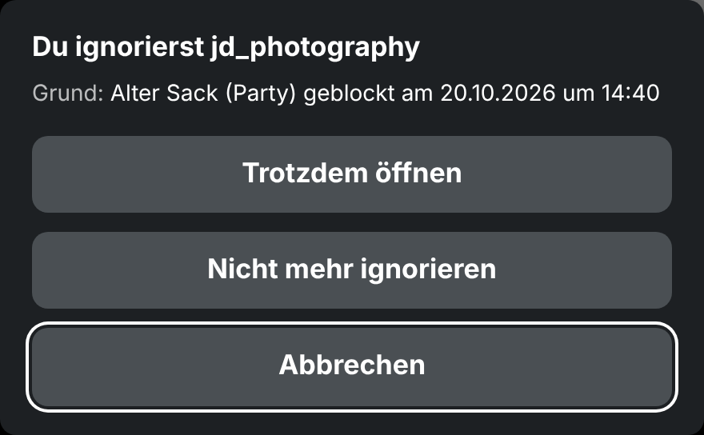
- Reiter **„Opa-Liste“** (zwischen „Dates“ und „Kommentare“): Testlauf des Scans für diese Party; listet alphabetisch alle bereits ignorierten bzw. die Kriterien erfüllenden Gäste mit Profil-Links und der Wahl *Ignorieren / Whitelist*, dann „Anwenden“.

### Partys synchronisieren (zwei Konten)

Auf der eigenen Seite der Eventanmeldungen (rechts neben „Opa-Scan starten“) und auf „Dates & Events“ (links neben „Opa-Scan starten“) steht der Button **„Synchronisieren“**. Er gleicht die Partys zweier Konten ab, z. B. in zwei Browser-Profilen.

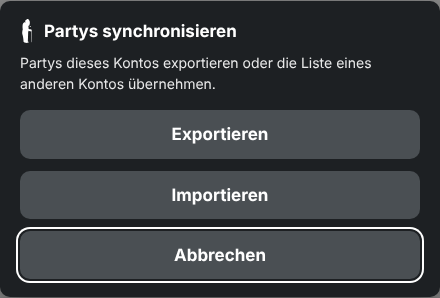

**Exportieren** liest alle kommenden Partys aus „Dates & Events“ (bei Bedarf im Hintergrund) und kopiert sie mit Titel, Datum, Ort, Link und Status – *Angemeldet* (inkl. Warteliste) oder *Vorgemerkt* – samt Konto und Zeitpunkt in die Zwischenablage.

**Importieren** fragt nach der Liste (Einfügen mit Strg+V), prüft sie und zeigt, von welchem Konto und wann sie stammt. Dann:

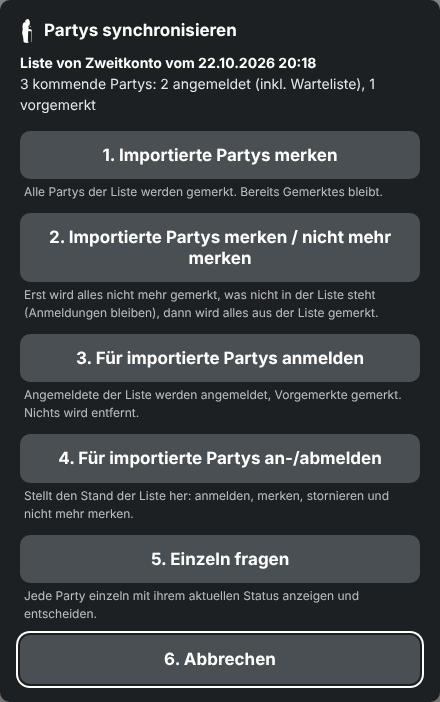

| Option | In der Liste | Hier angemeldet | Hier gemerkt | Hier nichts |
|---|---|---|---|---|
| 1. merken | angemeldet / vorgemerkt | bleibt | bleibt | merken |
| | nicht enthalten | bleibt | bleibt | – |
| 2. merken / nicht mehr merken | angemeldet / vorgemerkt | bleibt | bleibt | merken |
| | nicht enthalten | bleibt | nicht mehr merken | – |
| 3. anmelden | angemeldet | bleibt | anmelden | anmelden |
| | vorgemerkt | bleibt | bleibt | merken |
| | nicht enthalten | bleibt | bleibt | – |
| 4. an-/abmelden | angemeldet | bleibt | anmelden | anmelden |
| | vorgemerkt | stornieren, danach merken | bleibt | merken |
| | nicht enthalten | stornieren | nicht mehr merken | – |

- Bei 3, 4 und 5 fragt das Skript zuerst **„Anmeldung als“** (Mann / Frau / Paar; vorausgewählt ist der eigene Profiltyp, sonst Mann). Optionen des Veranstalters, Nachricht und „anonym“ bleiben leer bzw. auf „normal anmelden“.

  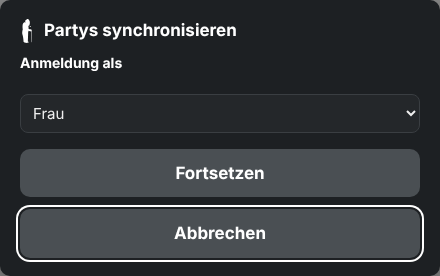
- Bei 4 listet eine Rückfrage vor dem Start alle Partys, die storniert würden. Gearbeitet wird in der Reihenfolge stornieren → nicht mehr merken / merken → anmelden, damit Plätze am selben Tag frei werden.

  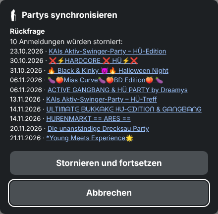
- **5. Einzeln fragen** prüft für jede Party den aktuellen Status und zeigt den Titel als Link (neuer Tab) mit **Merken / Nicht mehr merken**, **Anmelden / Abmelden** und **Überspringen** bzw. bei der letzten **Schließen**. Meldet JOYclub „bereits für zwei Veranstaltungen an diesem Tag angemeldet“, erscheinen die Partys dieses Tages je mit **„Diese stornieren und hier anmelden“**.

  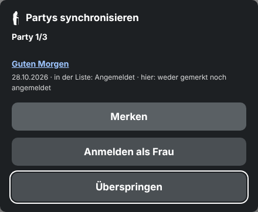
- Ergebnis jeder Anmeldung: „Du bist erfolgreich angemeldet!“ → angemeldet, „Du stehst auf der Warteliste.“ → Warteliste. Bietet eine Party den gewählten Typ nicht an (z. B. nur Paare) oder meldet JOYclub einen Fehler, wird sie übersprungen und am Ende mit Grund und Link aufgeführt.
- Merken und Anmelden laufen über die Formulare der Event-Seite; Stornieren klickt im unsichtbaren Frame „Stornieren“ und bestätigt „Anmeldung stornieren“. Danach prüft das Skript jeweils den neuen Status.

---

## Mitgliedersuche

Im Seitenkopf der Suche `/member/` steht rechts neben der Lupe (Namenssuche) ein eigener Button mit **Opa-mit-Lupe-Icon** . Er öffnet ein Popup mit den Möglichkeiten (ggf. auch „fortsetzen“):

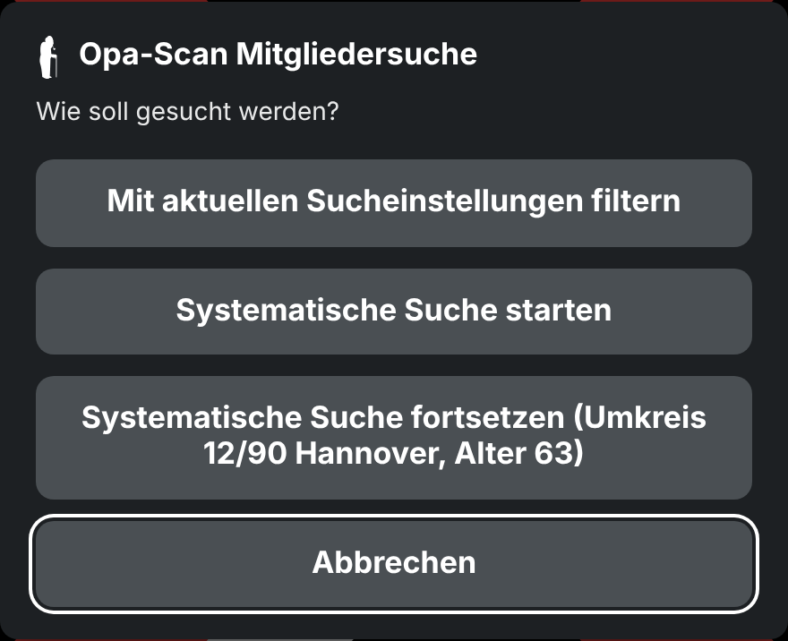

**Schwellen der Suche:** Standardmäßig steht „Ignorieren ab“ für die Mitgliedersuche in allen Gruppen auf 100 – die Suche findet weit mehr Treffer, als die Ignorierliste fasst. Der frühere Statistik-Modus (`SEARCH_IGNORE`) ist entfallen.

### Mit aktuellen Sucheinstellungen filtern

Lädt die gerade eingestellte Suche in einem unsichtbaren Frame komplett nach, bestimmt die Treffer nach den Regeln (Schwellen der Mitgliedersuche, Typen, Paar-Regeln, Whitelist) und ignoriert sie im Hintergrund (Notiz-Quelle „Suche“).

Ab 1.91 holt das Skript die Ergebnisse über JOYclubs Schnittstelle (`apiv2 /members`, dieselbe Anfrage, die die Suchseite gerade gestellt hat) Seite für Seite, ohne zu scrollen – Alter und Typ stehen direkt in den Treffern, die Profil-Links kommen gesammelt über `/profile/get_urls`. Klappt das nicht, lädt es wie bisher die Seite. Die systematische Suche nutzt vorerst weiter die Seite.
### Systematische Suche

Ein zweites Popup spiegelt die JOYclub-Filter **Ich suche** (Frauen, Männer, Paare, Non-binary) und **Alter** (18 bis 70+) und listet alle Bundesländer aus `CONFIG.AREAS` mit Checkbox und Zahl der Umkreise (Hamburg und Bremen laufen unter „Niedersachsen / Hamburg / Bremen“). Die Auswahl wird gemerkt.

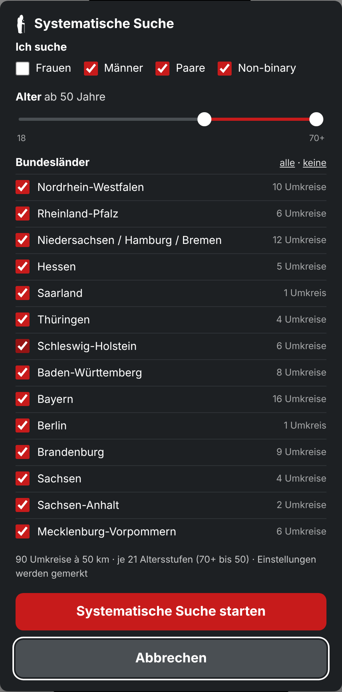

Ablauf:
- Für jeden Umkreis (50 km um eine Stadt) und jedes Alter einzeln – rückwärts von 70+ bis zur Untergrenze – wird die Suche per Deeplink aufgerufen:
  `/member/<ort>-x<GeoNames-ID>-r/is-<typen>/?user_geo_distance=50&user_age=<alter>_<alter>`
  (JOYclub nutzt GeoNames-IDs als Orts-ID; `70_70` bedeutet „70 und älter“, Werte über 70 kennt die Suche nicht – liegt eine Schwelle über 70, wird die Klasse 70+ durchsucht und nach dem genauen Alter gefiltert.)
- Jede Einzelsuche wird wiederholt, bis ein Durchlauf keine neuen Profile mehr bringt (höchstens 20, bei 70+ höchstens 200 Durchläufe); Treffer werden nach jedem Durchlauf ignoriert.
- Paare werden anhand ihrer zwei Altersangaben entschieden; Paare mit nur einer Altersangabe werden auf dem Profil geprüft und gesondert gemerkt.
- Zu Beginn jedes Such-Scans werden fällige Vorgemerkte (inzwischen an der Schwelle ihrer Gruppe und Quelle) ignoriert.
- Fortschritt: zwei Balken – **Gesamt** (jeder Umkreis zählt gleich viel; innerhalb eines Umkreises zählt 70+ zehnfach, jedes weitere Alter einfach) und **aktuelle Altersklasse**; die Kopfzeile zeigt Alter und Umkreis als „x/Gesamt“:

  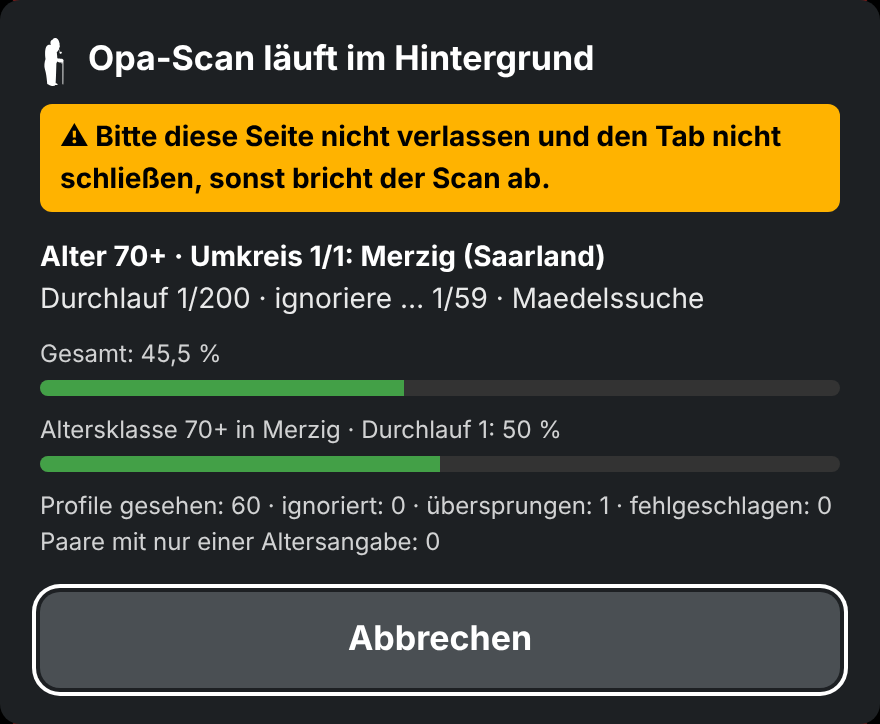

### Sonstiges

- Das Popup während des Scans entspricht dem des Party-Scans (Warnhinweis, Fortschrittsbalken, Statistik, Abbrechen); am Ende gibt es Export-Buttons für Paare mit einer Altersangabe und Fehlschläge.
- Header-Badge mit der Zahl der vom Skript blockierten Opas.
- **Markierung der Ergebnisse** (bei normalem Aufruf, nicht in den Scan-Frames): Karten werden wie Gästelisten auf Partys eingefärbt, ignorierte Mitglieder bleiben sichtbar und bekommen ein rotes X; ein Klick darauf öffnet das Popup *„Du ignorierst …“* („Nicht mehr ignorieren“ schreibt hier `Whitelist: Suche am …`). Bei eingeschalteter visueller Einstufung zeigen die Symbole die Stufe (Opa/Oma in Stufe 3).
- Eine unterbrochene systematische Suche (Abbrechen, Abmeldung) lässt sich im Auswahl-Popup an derselben Stelle fortsetzen.
- Die alte Behandlung der Suche (Panel, Automatik, Ignorieren im Tab) wurde in Version 1.73 entfernt.

---

## Wartung und Abmeldung

Alle Scans (Party, Mitgliedersuche, Gruppen, Profilprüfungen im Hintergrund) erkennen, wenn JOYclub statt der gewünschten Seite etwas anderes liefert:

| Seite | Erkennung | Reaktion |
|---|---|---|
| angemeldet | `body[data-session-user-id]` | normal weiter |
| abgemeldet | Gast-Seite („Erst einloggen, dann loslegen – Fehler 401“, `body.guest`, Login-Link) | Login in einem kleinen Fenster über `www.joyclub.de/webauth/login/` → `identity.joyclub.com`: sind Benutzername und Passwort (vom Browser) ausgefüllt, hakt das Skript „Angemeldet bleiben“ an und klickt „Login“ – höchstens einmal pro Abmeldung und einmal in 30 Minuten. Klappt das nicht (leere Felder, Cloudflare-Prüfung), pausiert der Scan, bis man sich im Fenster selbst angemeldet hat, und läuft dann weiter |
| Wartungsseite | weder angemeldet noch Login-Feld, **und** der Text nennt Wartung, „gleich wieder da“, Überlastung, 502/503 o. Ä. | Uhrzeit aus dem Hinweis lesen („bis voraussichtlich 17 Uhr“) und bis dahin plus zufällig 5–10 Minuten **gar nicht** auf JOYclub zugreifen (ohne Uhrzeit: 30 Minuten plus 5–10); danach den unterbrochenen Schritt wiederholen |

| unerwartete Seite | weder angemeldet noch Login noch Wartungs-Hinweis (z. B. Zwischen- oder Fehlerseite) | nach 1 Minute erneut versuchen, höchstens 3×; danach gilt nur dieser Schritt als Fehlschlag (z. B. diese eine Party), der Scan geht weiter |

Während einer Wartungspause nennt das Fenster den erkannten Hinweis und bietet **„Jetzt weiter“** (sofort erneut versuchen). Pausen zählen nicht als Fehlschlag, gelten für alle Tabs und stehen im Protokoll-Export der Mitgliedersuche. Während einer Pause heißt das Popup „Opa-Scan pausiert“. Erkannt werden Uhrzeiten wie „bis voraussichtlich 17 Uhr“, „ab 17:30 Uhr“ oder „17:00“.

**Ohne laufenden Scan:**

| Seite | Reaktion |
|---|---|
| Wartungsseite | Hinweis oben auf der Seite; neu geladen wird zur angegebenen Uhrzeit (jede neue Uhrzeit wird übernommen), ohne oder mit schon vergangener Uhrzeit nach 5, 10, 15 … höchstens 30 Minuten |
| „Erst einloggen, dann loslegen“ (401) | Hinweis oben und nach 1–2 Sekunden weiter über den Login-Knopf (mit Rücksprung auf die gewünschte Seite); dort meldet das Skript wie unten an. Schlug der letzte automatische Login in den vergangenen 30 Minuten fehl, nur der Hinweis „automatisches Anmelden gesperrt – bitte selbst einloggen“ |
| „Seite nicht gefunden“ | einmal neu laden; bleibt es dabei, wird die Adresse vermerkt (`jaf_notfound`) |
| Login-Seite (`identity.joyclub.com/ui/login/…`) | „Angemeldet bleiben“ setzen und „Login“ klicken, sobald der Browser Name und Passwort eingefüllt hat und die Cloudflare-Prüfung durch ist – höchstens einmal in 30 Minuten (gemeinsam mit dem Login aus einem Scan). Das Skript speichert kein Passwort. Chrome/Edge geben eingefüllte Passwörter oft erst nach einem Klick frei; klappt es nicht, erscheint „Bitte einmal selbst auf ‚Login‘ klicken“. |

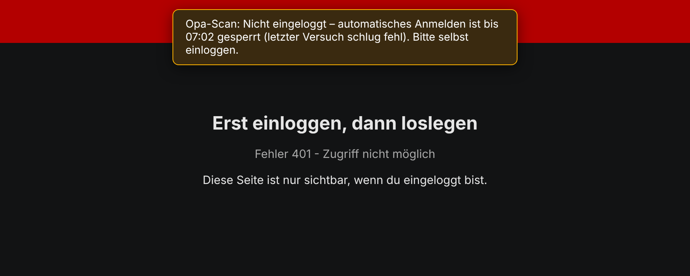

Werbeseiten werden behandelt, sobald ein Beispiel vorliegt.

---

## Ignorierliste synchronisieren

Auf `/ignore/` steht unter „Mitglied sperren“ der Button **Synchronisieren** (mit Kreispfeil) und darunter der Stand des letzten Abgleichs. Ein Klick öffnet:

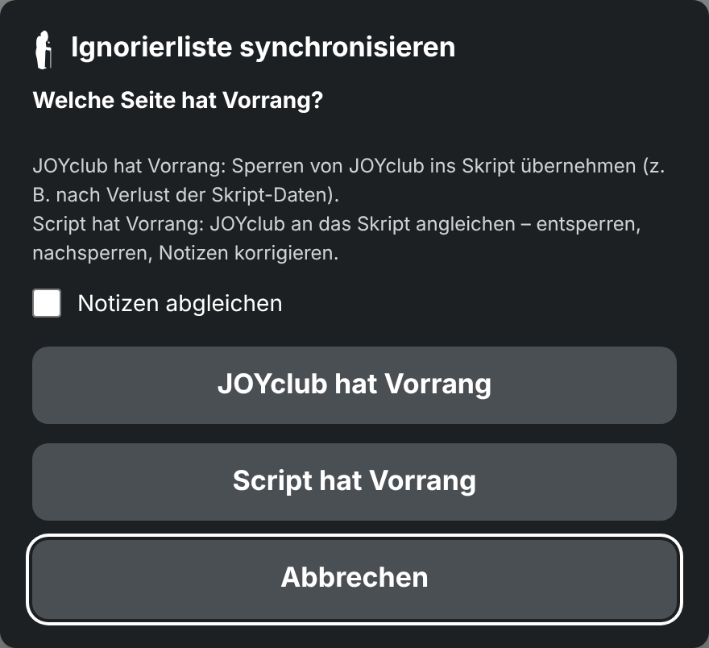

| Modus | Ohne „Notizen abgleichen“ | Mit „Notizen abgleichen“ |
|---|---|---|
| **JOYclub hat Vorrang** (z. B. nach Verlust der Skript-Daten) | auf JOYclub Gesperrte werden im Skript als gesperrt vermerkt; im Skript Gesperrte, die nicht mehr auf der Liste stehen, gelten als entsperrt; Whitelist-Mitglieder, die gesperrt sind, bleiben gesperrt und werden aufgelistet | zusätzlich Art, Quelle sowie Datum/Uhrzeit aus der Profilnotiz übernehmen |
| **Script hat Vorrang** | auf JOYclub entsperren, wer dem Skript nicht als gesperrt bekannt ist oder auf der Whitelist steht; im Skript Gesperrte, die auf JOYclub fehlen, mit Notiz wieder sperren | weicht die Notiz in Art („Alter Sack“ / „Sugar Daddy“ / „Geronto-Paar“) oder Quelle ab (auch: leer), wird entsperrt, die Notiz angeglichen und wieder gesperrt; bei Entsperrten werden die eigenen Notizzeilen entfernt (Whitelist-Mitglieder bekommen ihre Whitelist-Zeile) |

Fehlen dem Skript Angaben, ergänzt es sie beim ohnehin nötigen Profilaufruf (Typ, Alter); ist keine Quelle bekannt, gilt „Sync“. Das Popup zeigt den Fortschritt aus Einlesen und Änderungen (deren Umfang erst nach dem Einlesen feststeht) und warnt, die Seite nicht zu verlassen:

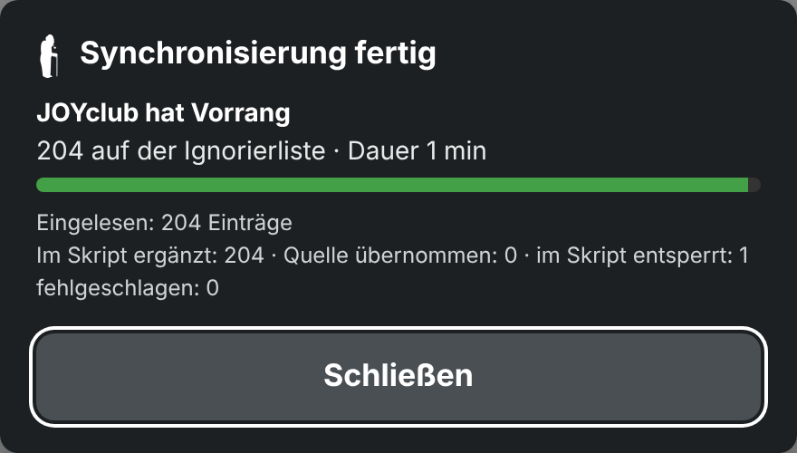

---

## Quellen, „zuletzt gesehen“ und das Limit der Ignorierliste

### Rangfolge

Jede Sperre merkt sich ihre Quelle. Standard: **Interaktionen** (`Likes`) > **Profilbesucher** (`Besucher`) > **Partygäste** (`Party`) > **Gruppen** > **Mitgliedersuche** (`Suche`) > **Synchronisation** (`Sync`); änderbar auf der Seite „Opa-Schutz“ (gilt ab dann, bestehende Sperren werden nicht umsortiert). Einträge ohne Quelle stehen ganz unten. Dieselbe Rangfolge gilt für die Quelle der Vorgemerkten. Die Profilnotiz auf JOYclub gleicht der nächste Sync „Script hat Vorrang“ mit Notizen an.

### „Zuletzt gesehen“

Gespeichert für Sperren und in der Konten-Liste: Partydatum (beim Scan und schon beim Ansehen einer Gästeliste), Besuchs- bzw. Like-Datum. Gruppen und Suche haben kein Datum.

| Sichtung in … | Ergebnis |
|---|---|
| höherer Quelle | Quelle steigt, Datum = Datum dieser Sichtung (darf dabei einmalig sinken) |
| gleicher Quelle | nur ein neueres Datum ersetzt das alte |
| niedrigerer Quelle | Quelle und Datum bleiben |

Beispiel: Partygäste, 01.10.2026 + „Mögen mich“ vom 25.09.2026 → Interaktionen, 25.09.2026. Wer früher auf einer Party war, aber jetzt über Gruppen oder Suche gesperrt wird, behält deren Quelle, bis ihn wieder eine Party zeigt.

### Limit und Verdrängung

JOYclub behält nur die letzten `IGNORE_LIMIT` (1000) Sperren. Jeder Scan liest zu Beginn die Ignorierliste ein und zeigt den Füllstand („Ignorierliste: 987/1.000 (13 frei)“). Ist sie voll, macht das Skript vor einer neuen Sperre genau einen Platz frei – und entfernt dabei die eigene Notizzeile des Verdrängten. Reihenfolge, wer zuerst weicht:

1. **Niedrigste Quelle** zuerst (Einträge ohne bekannte Quelle gelten als interne Quelle „Altbestand“ ganz unten).
2. **Art:** Oma → Sugar Mom → Geronto-Paar → Opa → Sugar Daddy.
3. **Am längsten nicht gesehen** – nur, wenn „zuletzt gesehen“ in der Vergangenheit liegt (eine heutige Party gilt als zukünftig).
4. **Altersregel:** die wenigsten Tage über der Ignorier-Schwelle (Geronto-Paar: die Person, die ihre Schwelle zuletzt erreicht hat). Das Alter kommt aus den Geburtszeiträumen (mit Sternzeichen).

Aus einer niedrigeren Quelle darf jeder weichen; aus derselben Quelle nur eine gleiche oder niedrigere Art. Von Hand oder über die Whitelist Gesperrte werden nie verdrängt, belegen aber Plätze. Ist nichts verdrängbar, wird nicht gesperrt („Limit erreicht, nicht gesperrt“).

### Gedächtnis

Das Skript merkt sich jedes Mitglied, das jemals gesperrt, verdrängt, vorgemerkt oder im Testmodus „würde gesperrt“ war – mit Quellen („zuletzt gesehen“ je Quelle), Status und Verlauf. Daraus berechnen die Einstellungsseite und das Speichern-Popup, wer nach neuen Regeln gesperrt wäre. Erfüllt jemand die Regeln in mehreren Quellen, zählt die höchste.

### Ignorierliste reparieren

Auf `/ignore/` steht neben **Synchronisieren** der Button **„Ignorierliste reparieren“**. Er zeigt, wie viele vom Skript gesperrte Mitglieder auf JOYclub fehlen (z. B. durch Überlauf herausgefallen), wie viele weniger wichtige Einträge dafür weichen würden und wie viele von Hand gesperrt sind (bleiben unberührt). **Jetzt reparieren** markiert die Fehlenden als „von JOYclub entfernt (Überlauf)“ und sperrt sie – wo nötig auf Kosten weniger wichtiger Einträge – wieder; **Abbrechen** ist vorausgewählt.

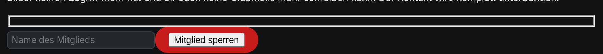

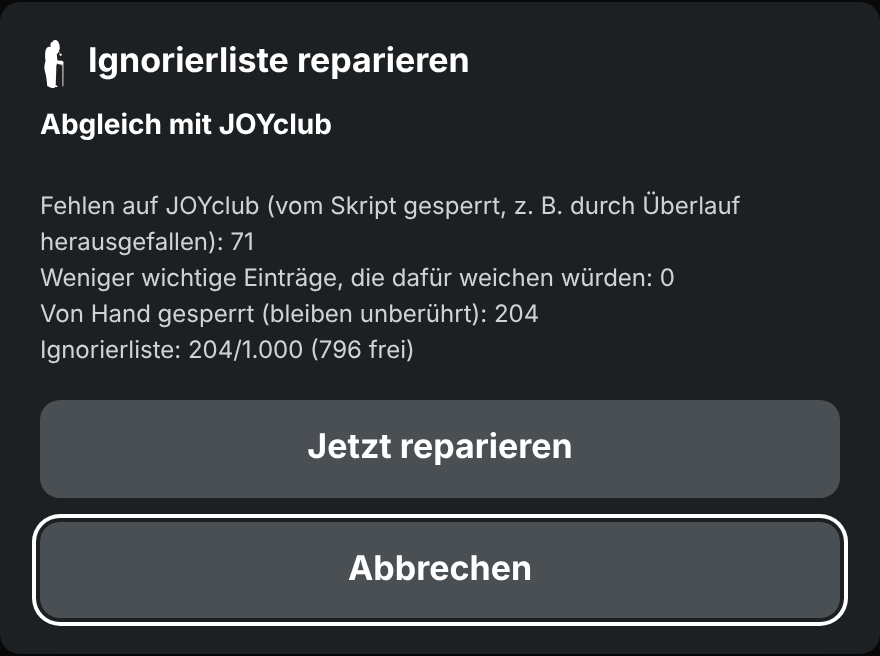

Im Script-Speicher steht beim Verdrängten „entsperrt (Platz für neue Sperre, Limit)“.

---

## Fickliste

Auf jedem Profil, das das Skript einordnen kann (Mann, Frau, Paar, Trans*, … – keine Clubs, Veranstalter oder Business-Profile, nicht das eigene Profil), steht zwischen „Match!“/„Gefällt mir“ und „ClubMail“ ein zusätzlicher runder Button. Alles bleibt **nur für dich sichtbar** und wird nur im Skript-Speicher abgelegt.

| Zustand | Symbol | Beschriftung |
|---|---|---|
| inaktiv | dünner Umriss | Ficken? |
| will ich ficken | gefüllt | Will ich |
| schon gefickt | gefüllt, roter Kreis | Gefickt |
| nie wieder | gefüllt im roten Verbotsring | Nie wieder! |
| will ich nicht | Umriss im roten Verbotsring | Nein, danke! |

Ein Klick öffnet ein Menü im Stil von „Gefällt mir“. Angeboten werden alle anderen Zustände und – sobald ein Zustand gesetzt ist – „Fickstatus zurücksetzen“ (Mülltonne). Auf Karten (Suche, Gästelisten, Besucher …) zeigt ein kleines Symbol den Zustand.

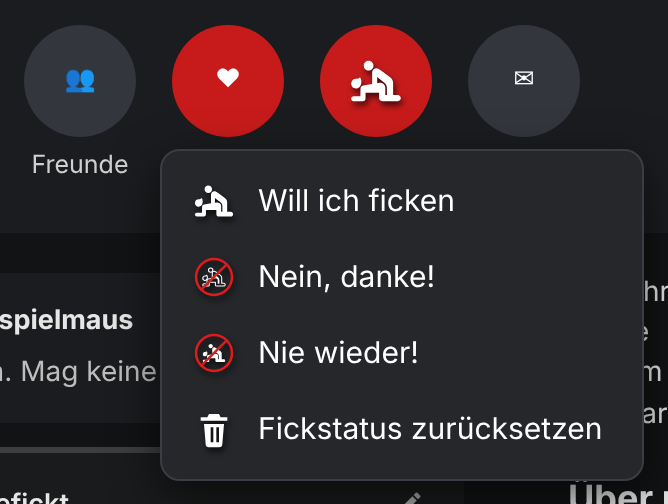

### Ficklisteneintragung

Jede Zustandsänderung öffnet das Popup „Ficklisteneintragung“:

- **Profilnotiz** (JOYclub) – vorbelegt, Änderungen werden auf dem Profil gespeichert.
- **Treffen** (beliebig viele, neueste oben): *was* (Party oder Anlass), *wo* (Club oder Ort, mit Vorschlägen aus allen bekannten Clubs), *am*, *um* und eine *Ficknotiz*. Vorbelegt mit der Party, aus deren Gästeliste du das Profil geöffnet hast. „Party wählen …“ bietet die Partys von heute und die letzten 10 vergangenen (eigene Anmeldungen mit ★) und eine Suche. Ein eingefügter Party-Link wird gelesen: Name (*was*), Club (*wo*), Datum und Beginn werden übernommen und bleiben änderbar, der Link bleibt dahinter gespeichert.
- **Anmerkungen** (allgemein).
- **als** – bei verknüpften Profilen gehört jedes Treffen einem der Profile (Auswahl je Treffen). Neue Treffen gehören dem betrachteten Profil, wenn es „Will ich“, „Gefickt“ oder „Nie wieder!“ hat, sonst (kein Status, „Nein, danke!“) dem primären. „Verknüpfte Profile …“ öffnet die Verwaltung, „Auch auf …“ die Profile auf anderen Plattformen.
- **Profil zukünftig ignorieren** – bei „Nein, danke!“ und „Nie wieder!“ vorausgewählt. Ist das Profil schon ignoriert, steht „Dieses Profil wird derzeit ignoriert!“ darunter; Abwählen entsperrt es (und setzt es auf die eigene Whitelist). Ignorieren hebt einen Whitelist-Eintrag auf. Bei vollem Limit weicht eine automatische Sperre – eigene Listen haben Vorrang.
- Enthält die Profilnotiz ein Datum ohne Treffen, schlägt das Skript passende Partys vor (Datum + Club oder Partyname; „am selben Tag“ als schwächere Vorschläge).

„Speichern“ ist vorausgewählt (Strg+Enter), „Abbrechen“ ändert nichts. „Fickstatus zurücksetzen“ fragt: *Zurücksetzen* (Treffen und Archiv bleiben), *Zurücksetzen und Daten löschen* (alles zu dieser Person) oder *Abbrechen*.

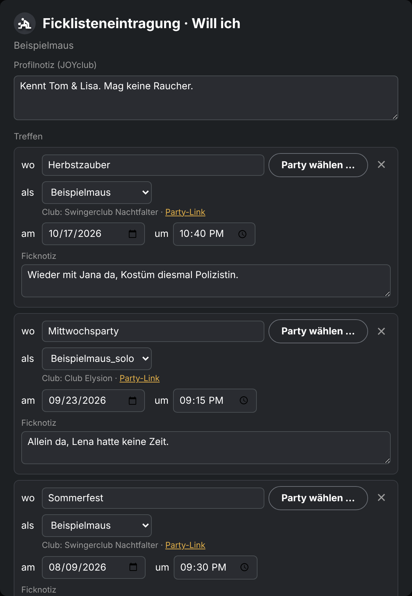 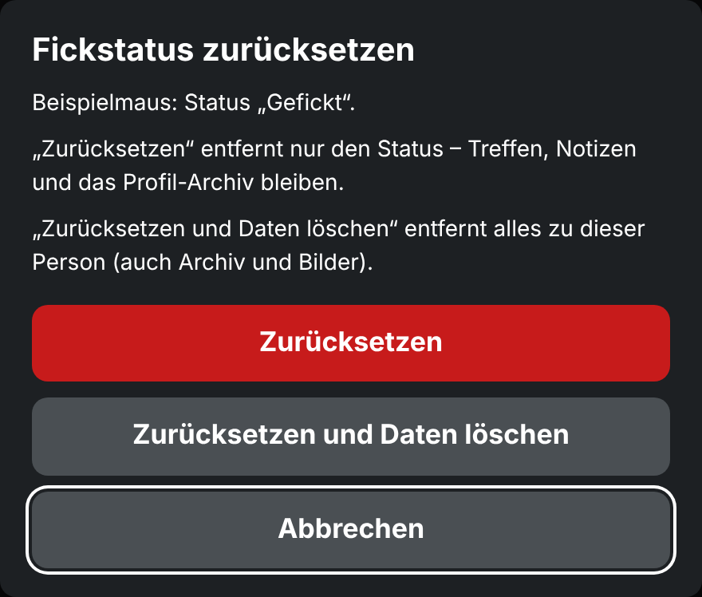

Unter der Profilnotiz (oben in der Liste der Profil-Badges) zeigt das Profil die Einträge (neueste drei, dann „Mehr anzeigen“, ohne Treffen: „Kein Treffen eingetragen“), die verknüpften Profile und den Link „Zu meiner Fickliste“; der Stift öffnet dasselbe Popup. Der Block erscheint bei jedem Status – bei „Nein, danke!“ als Liste der Begegnungen und Gründe – und auch auf verknüpften Profilen ohne eigenen Status („Fickliste · verknüpft mit …“).

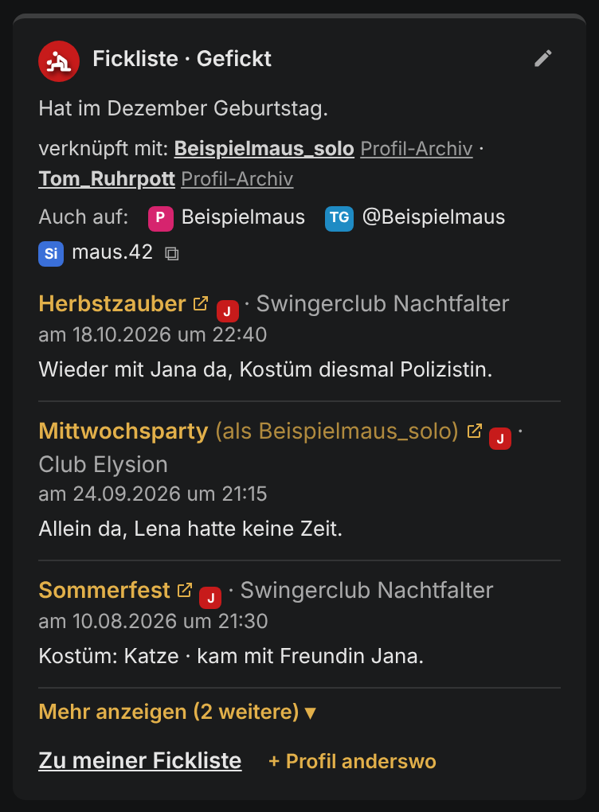 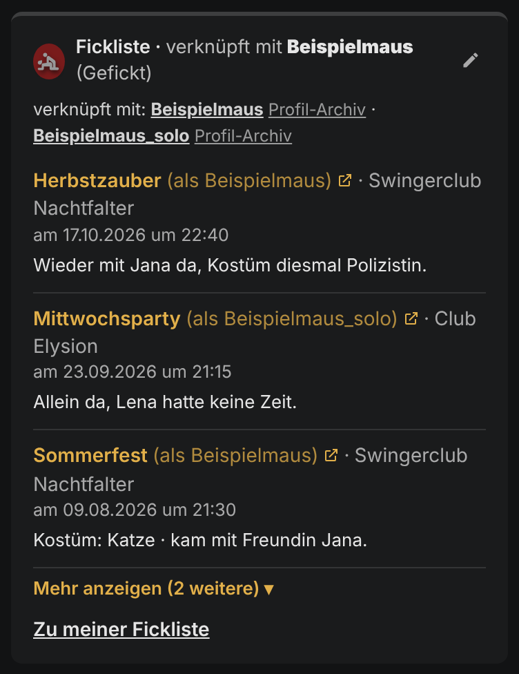

### Profil-Archiv

Beim Setzen eines Zustands und bei jedem späteren Profilbesuch mit Änderungen speichert das Skript einen **Stand**: Nick, Typ, Alter, Ort, Steckbrief(e), Profiltexte, deine damalige Profilnotiz und das **Profilbild in bester Qualität** (jedes neue Bild bleibt erhalten). Jeder Stand trägt Datum, Uhrzeit und Grund (z. B. „Fickstatus: Will ich → Gefickt“, „Profilbild geändert“, „Nick geändert“).

„Profil-Archiv“ öffnet den zuletzt betrachteten Stand. Eine Navigation blättert vor und zurück (‹ ›), springt mit « » nur zu den Ständen direkt vor und nach einem Treffen und wählt in der Mitte jeden Stand oder „aktuell (echtes Profil)“. Sie erscheint auch auf dem echten Profil, wenn du aus der Fickliste kommst, und lässt sich für diesen Tab mit ✕ beenden. Archiv-Stände erscheinen (wie externe Ficks) im Aussehen eines JOYclub-Profils auf deinem eigenen Profil als Trägerseite – mit Kopf, Suchkriterien, Profilnotiz, Fickliste-Block, Texten, Steckbrief und Vorlieben. Aktive Inhalte der Kopie führen zum echten Profil; gibt es das Profil nicht mehr, erscheint mittig „Dieser Benutzer ist nicht mehr auf JOYclub – Du betrachtest eine statische Kopie seines alten Profils“ (schließt nach 10 s).

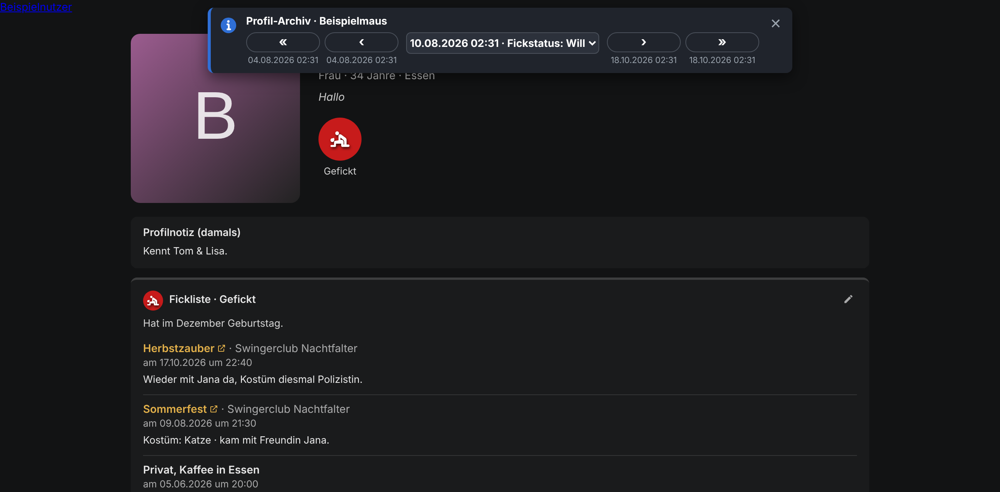

### Meine Fickliste

Unter **Profil verwalten → Fickliste** (erster Eintrag im Bereich „Community & Dating“ vor „Dates“, auch als Kachel dort auf der Startseite der Profilverwaltung und als erster Eintrag „Fickliste“ im Hamburger-Menü unter „Profil & Einstellungen“): jede Zeile ist ein Treffen; Personen ohne Treffen stehen mit „Kein Treffen eingetragen“ in der Liste (bei Datumssortierung am Ende, bei Namenssortierung alphabetisch; ausgeblendet, solange nach Wo, Club oder Datum gefiltert wird). Sortieren nach Name oder Datum (auf-/absteigend, Standard: neueste zuerst), filtern nach Mitglied (Vorschläge auch mitten im Nick), „Was/Wo (enthält)“, „Wo“ (Mehrfachauswahl inkl. „unbekannt“) und Datumsbereich; rechts die Zähler je Zustand als Filter. „Nein, danke!“ ist beim ersten Aufruf und nach „Filter zurücksetzen“ ausgeblendet; alle Filter und die Sortierung bleiben gespeichert. Der Nick öffnet das Profil (neuer Tab), „Profil-Archiv“ steht bündig untereinander, ein Klick auf die Zeile öffnet die Eintragung. Gelöschte Profile sind durchgestrichen, vorübergehend deaktivierte rot.

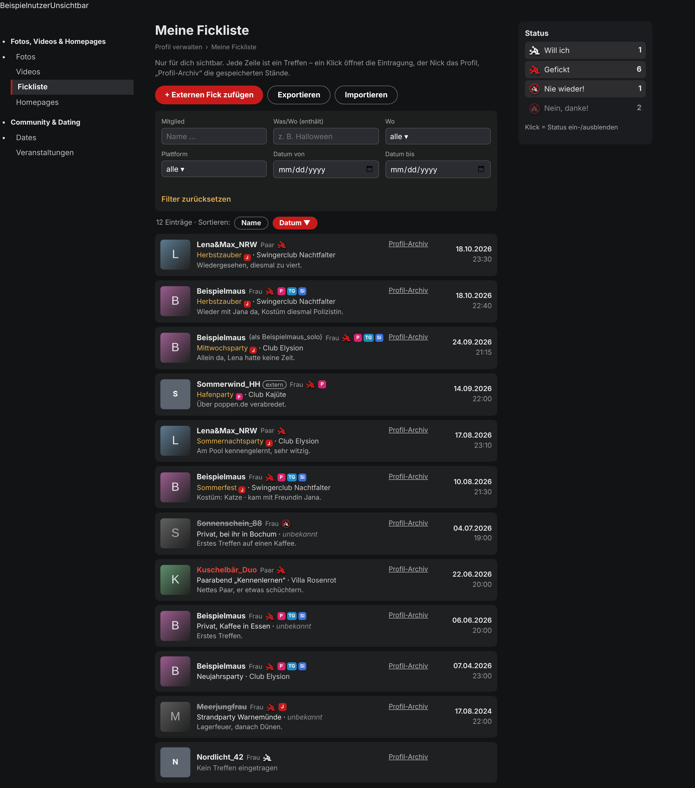

Solange die Seite offen ist und du **unsichtbar** eingeloggt bist, prüft das Skript im Hintergrund höchstens einmal täglich je Profil, ob es noch existiert.

### Eigenes Profil

Hinter „Freunde“ steht der Reiter „Fickliste“; über „Account“ ein Kasten „Fickliste – Nur für dich sichtbar“ mit den Zählern je Zustand (Klick filtert), den letzten Ficks mit drei verschiedenen Personen und „Zu meiner Fickliste“.

 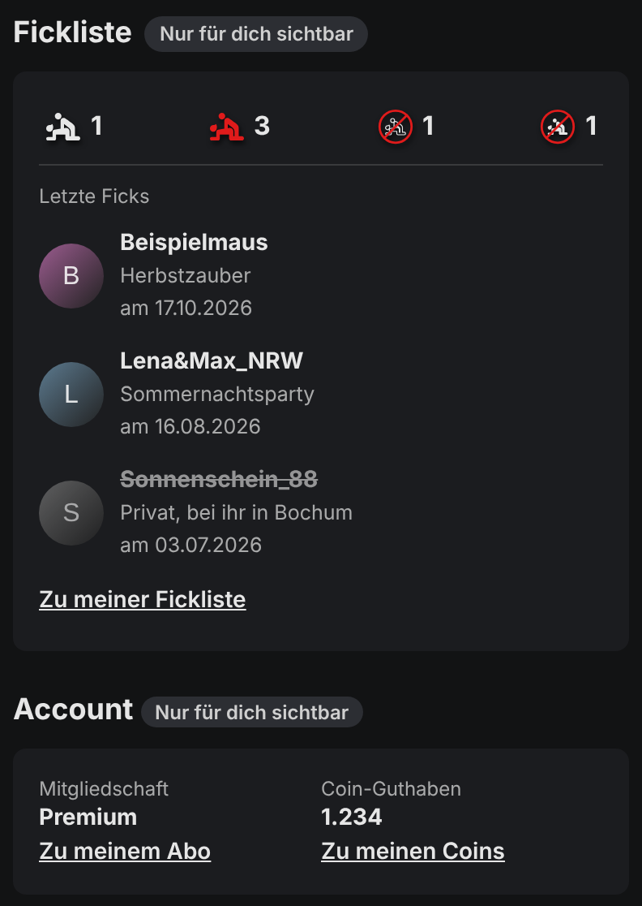

### Externe Ficks

„+ Externen Fick zufügen“ legt eine Seite im Aussehen eines JOYclub-Profils an; sie wird auf deinem eigenen Profil dargestellt (Adresse: dein Profil mit `?fl=x-<name>`). Profilbild (Klick aufs Bild), Kopf (Typ, Alter, Ort, Kurztext), Suchkriterien, Profilnotiz, Texte (Motto, Profiltext, Das mag ich / nicht), Steckbrief und Vorlieben sind per Stift editierbar; jede Änderung wird ein Archiv-Stand. Mit „war bei JOYclub“ verhält sich der Eintrag wie ein gelöschtes Profil und lässt sich über „Mit JOYclub-Profil verknüpfen“ einem echten Profil zuordnen.

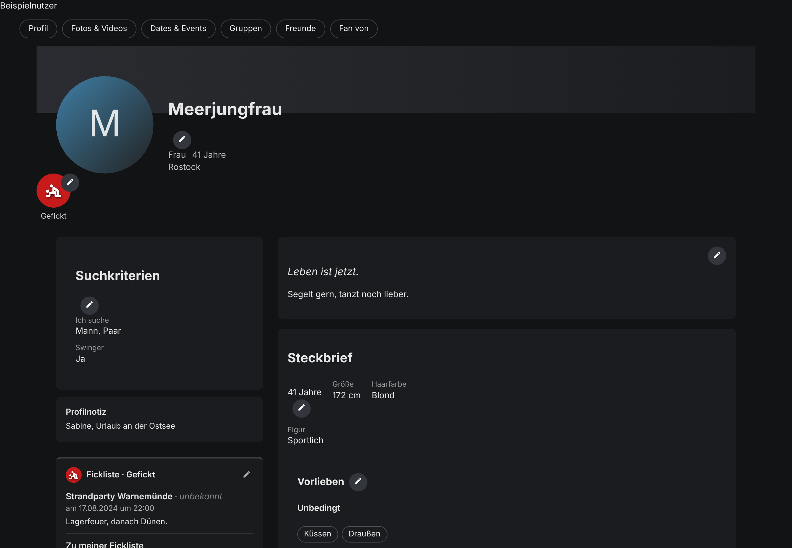 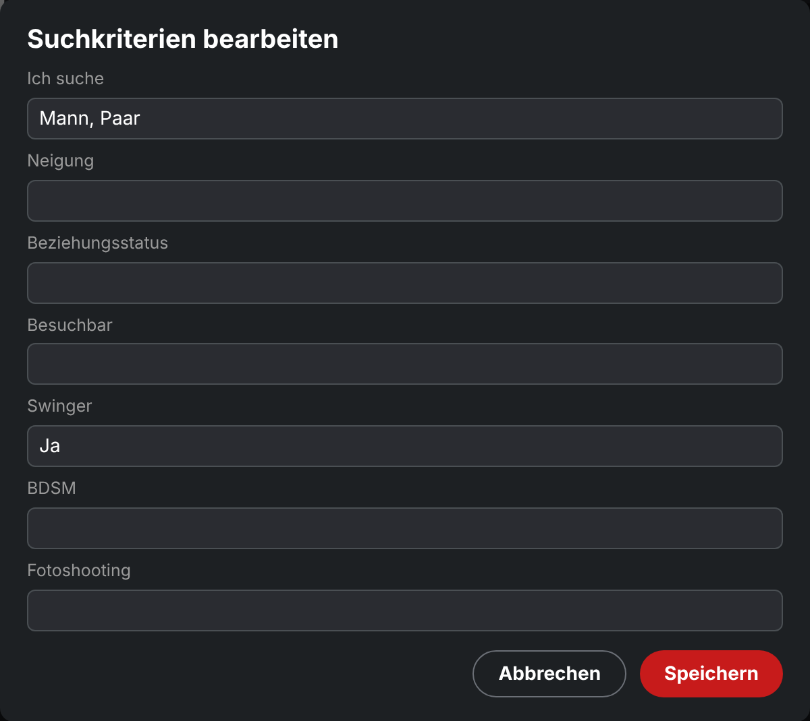

### Verknüpfte Profile

Gehört eine Person zu mehreren Profilen (z. B. Paarprofil, ihr eigenes und sein eigenes), verknüpfst du sie über „Verknüpfte Profile …“ in der Eintragung: Profil-Link einfügen oder Nick suchen (ab 2 Zeichen; erst Treffer aus der Fickliste, dann „Weitere bekannte Profile“ aus allem, was das Skript kennt – mit Typ und Alter). Der echte Nick wird aus bekannten Daten oder der Profilseite gelesen. Ein Status setzen oder zurücksetzen hebt die Verknüpfung nicht auf. Eines ist **primär**: In „Meine Fickliste“ und auf Party-Seiten steht die Person unter dem primären Nick und Status; Treffen eines anderen Profils tragen „(als …)“. Ist auf einer Party nicht das primäre, aber ein verknüpftes Profil angemeldet, steht ebenfalls „(als …)“ dahinter. „Status mit primärem Profil synchron halten“ übernimmt Statuswechsel des primären Profils (z. B. nicht beim Mann, mit dem nichts lief). Die Einträge werden nicht zusammengelegt – jede Verknüpfung lässt sich wieder lösen.

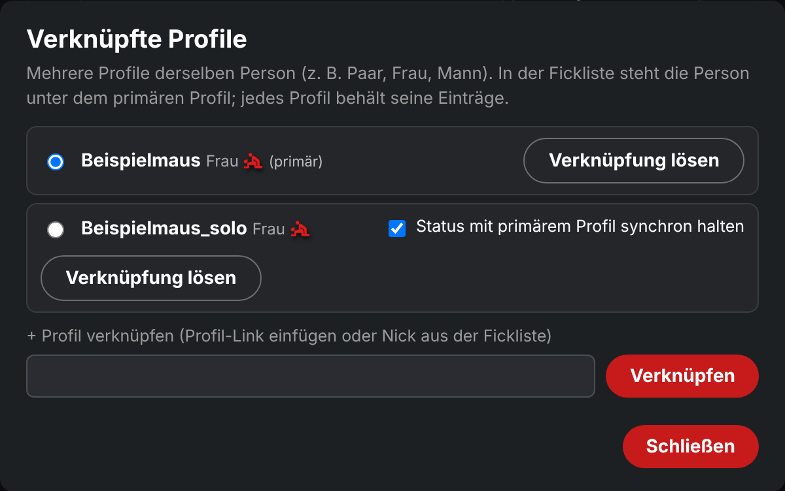

### Profile anderswo („Auch auf …“)

Jede Person kann Profile auf anderen Plattformen und Messenger-Kontakte haben: poppen.de, xHamster, Eronity, SpicyMatch, Kaufmich, Fetish.com, Gays.com, Telegram, WhatsApp, Threema, Signal oder „Andere …“ (freier Name). Der breite Knopf **„+“** am Ende der Zeile „Auch auf:“ im Fickliste-Kasten (Profilseite und Seite externer Ficks; ohne Profile direkt hinter „Auch auf:“) und „Auch auf …“ in der Ficklisteneintragung (erreichbar von überall, auch per Klick auf eine Zeile in „Meine Fickliste“) öffnen die Verwaltung; je Profil lässt sich „Profil gelöscht“ setzen. Im Kasten, in der Verwaltung, in „Meine Fickliste“ (auch im Filter **Plattform**) und bei Treffen-Links zeigt das Favicon der Plattform die Herkunft (Tooltip: Plattformname, ggf. „Profil gelöscht“).

Die Favicons sind nicht im Skript enthalten: Jedes wird einmal im Browser über den Favicon-Dienst von Google geladen und dauerhaft im Tampermonkey-Speicher abgelegt (`jaf_pf_icons`; neue Berechtigung `@connect www.google.com`, `gstatic.com`). Bis dahin – und für „Andere …“ – erscheint ein Kästchen mit Kürzel (wie im Bild). Die Symbole gehören den jeweiligen Markeninhabern.

| Plattform | Eingabe | gespeichert als |
|---|---|---|
| Telegram | `@Name`, `t.me/Name`, `telegram.me/Name` | `https://t.me/Name` (Vergleich ohne Groß/klein, Anzeige wie eingegeben) |
| WhatsApp | Telefonnummer in jeder Schreibweise oder `wa.me`-Link | `https://wa.me/<Ländervorwahl+Nummer>` (ohne Vorwahl: +49), Anzeige „+49 177 1234567“ |
| Threema | 8-stellige ID oder `threema.id`-Link | `https://threema.id/ID` (Großbuchstaben) |
| Signal | Telefonnummer / `signal.me`-Link / Benutzername | `https://signal.me/#p/+49…`; Benutzername nur als Text mit Kopieren-Knopf |
| andere | Profil-Link oder Name | Link vollständig |

Unter poppen.de schlägt die Verwaltung importierte poppen-Einträge vor; ein Klick führt sie mit dieser Person zusammen (gemeinsamer Status – der neuere gewinnt –, alle Treffen und Profile).

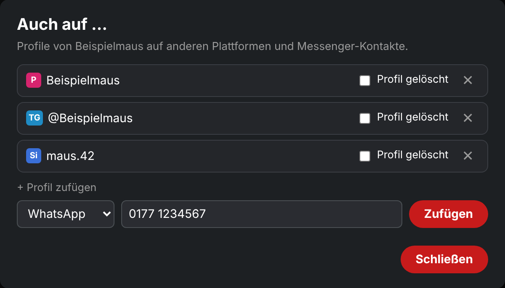

### Abgleich mit poppen.de (Export/Import)

„Exportieren“ und „Importieren“ in „Meine Fickliste“ tauschen die Fickliste mit dem Skript auf poppen.de aus (Datei oder Zwischenablage). Format `fickliste` v1 (poppen 2.1): Exporte sind mit dem eigenen Nick verschlüsselt (AES-GCM 256, PBKDF2-SHA256, 150 000 Runden), unverschlüsselte Dateien werden auch gelesen.

- **Erkennen:** Jeder Link wird mit allen bekannten Profilen verglichen – vereinheitlicht (Groß/klein, http/https, www., Umlaut-Kodierung, ?-Zusätze egal) und über die Profil-ID. Treffer → Verknüpfen und alle weiteren Links übernehmen; passt ein Eintrag zu zwei verschiedenen Personen, fragt das Skript „Zusammenführen / Getrennt lassen“; ohne Treffer entsteht eine neue Person (der Nick verlinkt dann auf ihr Profil dort, „Profil-Archiv“ gibt es nur mit JOYclub-Ständen).
- **Status:** je Profil gewinnt die neuere Änderung; ändert poppen.de den Status einer Person, gilt er für das primäre Profil und die synchron gehaltenen.
- **Treffen:** gleiche Treffen-ID → nur Fehlendes ergänzen; sonst gleich bei Plattform, Profil, Datum, Was, Wo und Link; ansonsten neu – nie überschrieben. Felder: `where` = „was“, `club` = „wo“.
- **Anmerkungen:** `persons[].notes` (höchstens 8000 Zeichen) mit `notesAt` und `notesBy` (Plattform, Konto); gleicher Text bleibt, sonst gewinnt die neuere Fassung. Ficknotizen tragen `noteAt`/`noteBy` je Treffen. `joy.notes` wird vorerst zusätzlich geschrieben und von älteren Ständen gelesen.
- **JOYclub-Profil in einem fremden Eintrag:** Hat ein importierter Eintrag (z. B. von poppen.de) ein JOYclub-Profil, wird er zu einem JOYclub-Eintrag: JOYclub wird Hauptprofil, das fremde Hauptprofil bleibt unter „Auch auf“ (im Austausch `main:true`); Status (neuerer gewinnt), Treffen, Profile und Verlauf werden übernommen, gibt es den JOYclub-Eintrag schon, wird zusammengeführt. Sofort, wenn die ID aus dem Link oder über den Nick bekannt ist, sonst beim nächsten Aufruf des Profils. Der Nick in „Meine Fickliste“ öffnet dann das JOYclub-Profil, und auf dem Profil erscheint der Fickliste-Kasten. Ältere Importe werden beim Start einmal entsprechend umgestellt.
- **Verknüpfte JOYclub-Profile** bleiben vollständig erhalten (eigener Status, „synchron halten“, Treffen je Profil); unbekannte Felder werden unverändert durchgereicht.
- Am Ende: neu / automatisch verknüpft / Konflikte / unverändert.

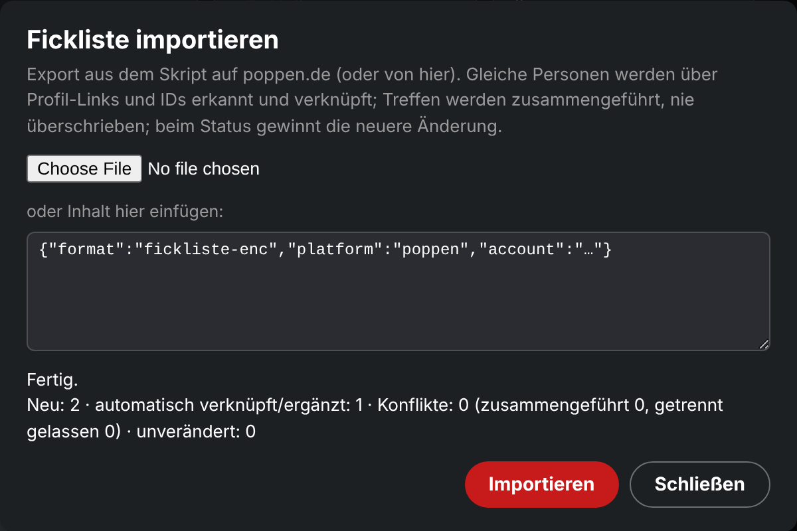

### Automatischer Abgleich (Briefkasten)

Ist auch das Skript für poppen.de installiert, gleichen sich Fickliste und Textvorlagen **ohne Export/Import** ab – sofort nach jeder Änderung, auf JOYclub wie auf poppen.de. Dafür bettet das Skript unsichtbar eine leere Seite ohne eigenen Code ein (`https://schimmelreiter.github.io/joyclub-opa-scan/briefkasten.html`, GitHub Pages dieses Repositorys). Beide Skripte laufen darin und tauschen über deren Browser-Speicher aus; die Seiten von JOYclub und poppen.de kommen an diesen Speicher nicht heran, die Daten verlassen den Browser nie.

- **Fickliste:** geänderte Personen werden einzeln übertragen, beim ersten Kontakt die ganze Liste; eingehende Personen werden wie beim Import abgeglichen.
- **Textvorlagen:** nach jedem Abgleich mit JOYclub (Öffnen der Vorlagen, Speichern, alle 15 Minuten) gehen geänderte Vorlagen hinüber; eingehende werden nach den Import-Regeln eingemischt (Dreiwege-Abgleich, Smileys übersetzt).
- **Rückfragen** (eine Person passt zu zwei Einträgen; beide Seiten haben eine Vorlage verschieden geändert, z. B. in der JOYclub-App) werden nicht mitten im Surfen gestellt, sondern beim nächsten Öffnen von „Meine Fickliste“ bzw. der Textvorlagen.
- Auf poppen.de ist dieses Skript **passiv**: keine Oberfläche, keine Eingriffe, keine Aufrufe – nur der Briefkasten. Umgekehrt genauso.
- **Status** unter Experten-Einstellungen › „Abgleich mit poppen.de“: aktiv, „Briefkasten blockiert“ (Sicherheitsrichtlinie oder Werbeblocker), „Speicher gesperrt“ („Drittanbieter-Cookies blockieren“) oder „poppen-Skript noch nicht gefunden“. In allen Fällen bleibt Export/Import per Hand.

### Gelöschte Kontakte (ClubMail)

Unterhaltungen mit gelöschten Mitgliedern (Nick ohne Profil-Link) und die JOY-Team-Nachricht „Dein Kontakt … hat sich gelöscht“ markieren Einträge der Fickliste sofort als gelöscht. Ist das Mitglied in der Fickliste, erscheint sein Nick durchgestrichen, ein Klick öffnet das Profil-Archiv und statt des Platzhalters steht das letzte Profilbild aus dem Archiv (unbekannte Konten bleiben, wie JOYclub sie zeigt); die Anmerkungen aus der Nachricht werden als Profilnotiz archiviert. Ist der Kontakt noch nicht in der Fickliste, steht in der Nachricht „+ Zur Fickliste hinzufügen“ – mit Nick, Anmerkungen und, wenn möglich, der passenden Party.

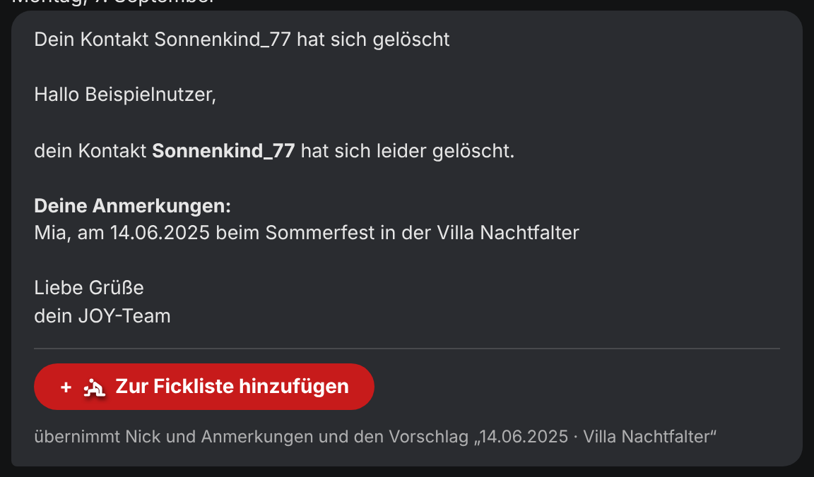

### Auf der Party-Seite

Sind Treffen der Fickliste mit einer Party verknüpft, erscheint auf ihrer Seite hinter „Opa-Liste“ der Reiter **„Fickliste“**: alle Ficks dieser Party in alphabetischer Reihenfolge, genauso dargestellt wie in „Meine Fickliste“. Treffen ohne Party-Link, deren Datum (auch Vortag ab 17 Uhr) und „wo“/Club zur Party passen, werden dabei automatisch mit ihr verknüpft.

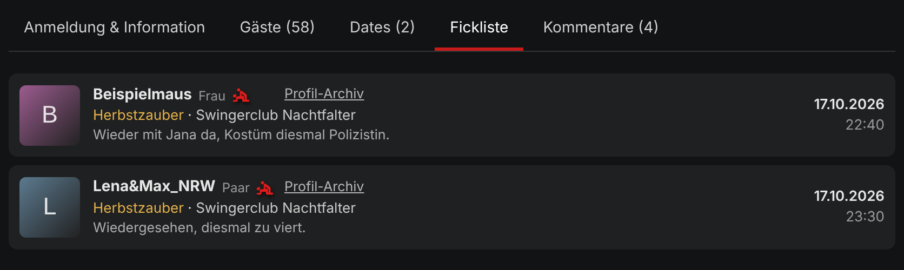

Jede geöffnete Party-Seite wird (auch rückwirkend für vergangene Partys) mit Name, Beginn, Link und Club gemerkt – so lassen sich alte Treffen zuordnen. In alten Gästelisten tauchen gelöschte Profile nur noch als anonyme oder externe Anmeldung auf.

Symbol: „sex-doggy“ von SVG Repo, als Umriss/Verbotsring abgewandelt.

---

## Region (Ruhrgebiet)

Das Skript liest den Ort des eigenen Profils (Kreis bzw. kreisfreie Stadt) und ordnet ihn dem Ruhrgebiet, dem Rheinland oder „anderswo“ zu. Im **Ruhrgebiet** heißt alles „Oppa“ und „Omma“ (Oppa-Scan, Oppa-Schutz, Oppa-Liste, blockierte Oppas/Ommas, Standard-Bezeichnungen der Stufe 3 und damit auch neue Notizen); eigene Bezeichnungen bleiben unverändert, alte Notizen werden weiter erkannt. Ein Ortswechsel wirkt sofort.

---

## Textvorlagen (ClubMail)

In **ClubMail › Optionen › Textvorlagen** ergänzt das Skript JOYclubs eigene Verwaltung:

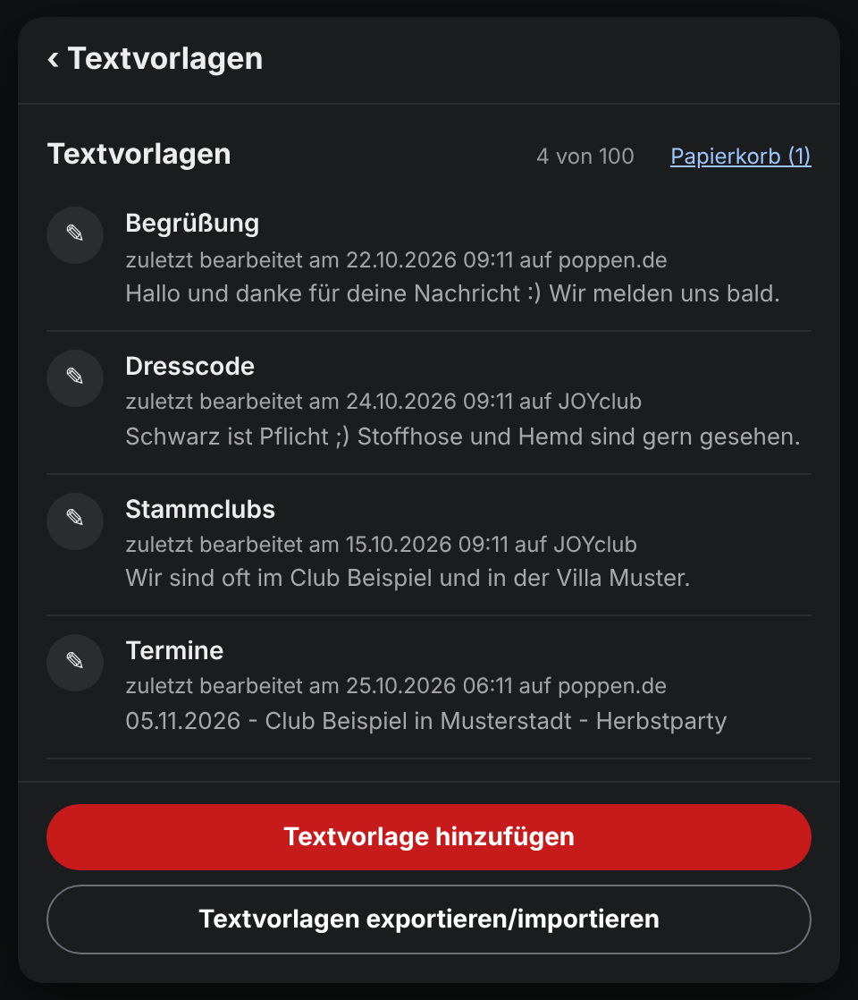

- **„zuletzt bearbeitet am … auf …“** unter dem Namen jeder Vorlage (JOYclub oder poppen.de). Änderungen, die ohne Skript gemacht wurden (App, anderer Computer), bemerkt das Skript beim nächsten Öffnen.
- **Papierkorb (N)** neben „N von 100“: gelöschte Vorlagen bleiben 30 Tage und lassen sich wiederherstellen.
- **„Textvorlagen exportieren/importieren“** unter „Textvorlage hinzufügen“: erst „Exportieren“ / „Importieren“ / „Abbrechen“, dann „per Datei“ oder „per Zwischenablage“ (lässt der Browser das Lesen nicht zu, erscheint ein Feld zum Einfügen). Die Datei ist mit dem eigenen Nick verschlüsselt (gleiches Format wie die Fickliste, Feld `templates`). Sie dient als **Sicherung** (Import vom selben Konto fragt „Ersetzen“ oder „Ergänzen“), zum **Abgleich mit dem Zweitkonto** und mit dem **Skript auf poppen.de**.

  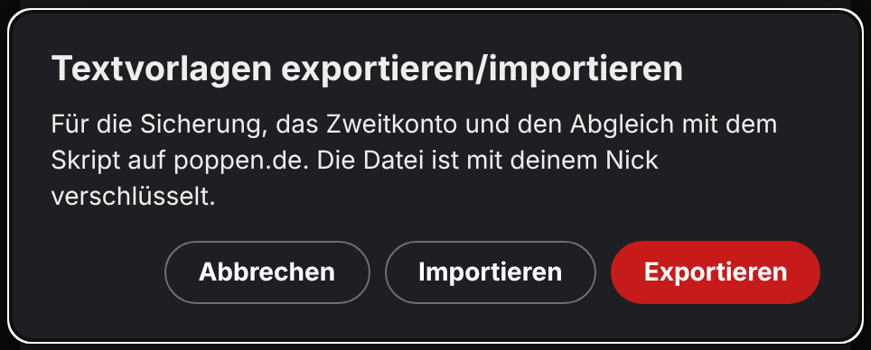

**Abgleich beim Import** (gilt auch für die Anmerkungen und Ficknotizen der Fickliste): Zuordnung über eine feste Kennung, sonst über den Namen. Verglichen wird ohne Smileys und Emojis und ohne Unterschiede im Leerraum.

| Fall | Ergebnis |
|---|---|
| gleich bis auf Smileys | unverändert – die eigene Fassung bleibt |
| seit dem letzten Abgleich nur auf der anderen Seite geändert | übernommen |
| nur hier geändert | bleibt |
| die andere Fassung hat vorn/hinten mehr oder neue Absätze | nur das Neue wird eingemischt („ergänzt“), der Rest bleibt |
| sonst | Rückfrage mit beiden Fassungen: „Diese behalten“, „Die andere übernehmen“, „Beide (umbenannt)“ |
| auf der anderen Seite gelöscht | hier ebenfalls in den Papierkorb (Rückfrage, wenn hier geändert) |
| neu | wird angelegt (höchstens 100 Vorlagen, je 8000 Zeichen) |

Am Ende steht ein Bericht je Vorlage und die Liste der Smileys, die sich nicht übersetzen ließen.

**Smileys:** Beim Import von poppen.de werden `:name:`-Codes und Emojis in JOYclub-Smileys übersetzt; allgemeine Kürzel (`:)`, `:D`, `;)` …) haben Vorrang vor `*name*`. Unbekannte Codes bleiben stehen. In Links wird nichts übersetzt.

**Termine:** Enthält der Name einer Vorlage „Termin“, erscheint unter dem Textfeld der Bereich **Termine**. Er liest eine Textdatei auf deinem Computer (einmal wählen, Chrome; Zeilen `wann - wo - was - Link`, Link freiwillig), nimmt die ersten fünf kommenden Termine (heute zählt) und zeigt sie nach Datum sortiert als Knöpfe. Ein Klick fügt den Termin an der Schreibmarke ein (sonst am Ende), getrennt durch eine Leerzeile: mit Link als `wann - wo - Link` (JOYclub zeigt statt des Links den Partynamen), sonst `wann - wo - was`. **„Alle übernehmen“** ersetzt den Text durch alle fünf. Weitere Knöpfe: „Datei mit Terminen wählen …“, „Datei ändern …“, „Zugriff auf die Datei erlauben“; ohne passende Zeilen steht „Keine kommenden Termine“.

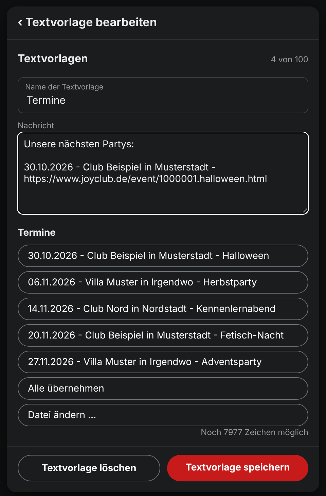

Mit dem Skript für poppen.de gleichen sich die Vorlagen auch automatisch ab (siehe Fickliste › „Automatischer Abgleich (Briefkasten)“).

Die Vorlagen liest und schreibt das Skript über JOYclubs Schnittstelle (`apiv2 /users/<id>/notes`). Anlegen und Löschen sind noch nicht durch einen Mitschnitt bestätigt; schlägt etwas fehl, meldet der Import das und bittet um einen Mitschnitt mit dem API-Rekorder.

---

## Profilseiten

- Im Slider „Dates & Events“ stehen Scan-Datum und AWO-Faktor der Partys (siehe [AWO-Faktor](#awo-faktor)).
- Der Profiltyp im Profilkopf wird bei eingeschalteter visueller Einstufung zur Bezeichnung der Stufe (z. B. Opa, Oma, Geronto-Paar; Symbol in Stufe 3). Werte: höchste Quelle, in der das Mitglied gesehen wurde.
- Alter, Typ, „zuletzt online“ und „Profil zuletzt aufgerufen“ werden mitgeschrieben; daraus berechnet das Skript Geburtsjahr-Spannen (bei Paaren für beide Personen).
- **Typwechsel** (z. B. Mann → Paar): Der neue Typ gilt; Konto, Gedächtnis, Profilinfos und Fickliste vermerken „Typ geändert: Mann → Paar“ (in der Fickliste zusätzlich als Archiv-Stand). Ändert sich die Zahl der Personen, beginnen die Geburtsjahr-Spannen neu. Vom Skript ignorierte Mitglieder werden neu beurteilt: passt die Regel nicht mehr, entsperrt das Skript sie und entfernt seine Zeile aus der Profilnotiz („entsperrt: Typ gewechselt (Mann → Paar)“); passt sie weiter, wird nur die Bezeichnung in der Notiz angepasst. Neu passende Mitglieder sperrt der nächste Scan; von Hand Gesperrte bleiben unberührt.
- **Sternzeichen** aus dem Steckbrief grenzen den Geburtszeitraum weiter ein (Grenztage ±1 Tag; bei Paaren je Person über Geschlechts-Symbol und Alter zugeordnet). Passt ein Sternzeichen nicht zum Zeitraum, wird es ignoriert.

---

## Sicherung, Exporte und Menü

Im Tampermonkey-Menü:

| Menüeintrag | Inhalt |
|---|---|
| Alle Daten sichern (JSON) | eine Datei mit allem: Einstellungen, Gesperrte, alle Konten, Vorgemerkte, Whitelist, Gruppen, Gedächtnis, Party-Stände … Die **Fickliste** ist mit deinem Nick verschlüsselt (kein durchsuchbarer Klartext). |
| Alle Daten wiederherstellen (JSON) | ersetzt nach Rückfrage alle Daten durch eine Sicherung; nach einem Nick-Wechsel wird der damalige Nick abgefragt (oder ohne Fickliste wiederherstellen) |
| Fremde Datensicherung importieren (mischen) | übernimmt aus der Sicherung eines anderen Kontos nur das Wissen über andere Mitglieder: Typ, Geburtszeiträume (geschnitten), Sternzeichen, Online-Angaben, geprüfte Profile, Geschlechts-Zuordnung, unbekannte Typen. Abgleich über die Profil-ID; der zuletzt aufgerufene Stand gewinnt, bei Gleichstand der vollständigere, dann der eigene. Nicht übernommen: Partys/AWO, Einstellungen, Whitelist, Sperren, Ignorierliste, Gedächtnis, Vormerkliste, Sichtungen, Fickliste. Am Ende: neu / aktualisiert / eigene behalten. |
| Unbekannte Profiltypen exportieren | vom Skript gefundene, unbekannte Profiltypen mit Beispielen |
| Online-Angaben exportieren | vorkommende „zuletzt online“-Texte |
| Fehlschläge des Party-Scans exportieren / löschen | gespeicherte Fehlschläge |
| Paare mit nur einer Altersangabe exportieren | in der Suche gefundene Paare mit nur einem Alter |
| Fehlschläge der Mitgliedersuche exportieren | gespeicherte Fehlschläge der Mitgliedersuche |
| Einstellungen (Opa-Schutz) öffnen | öffnet die Seite „Opa-Schutz“ |
| Partys beim nächsten Scan vollständig prüfen | vergisst die bereits geprüften Anmeldungen |
| Erledigt-Liste leeren | löscht das Protokoll der vom Skript Ignorierten (mit Rückfrage) |
| Fehlschläge leeren | löscht alle gespeicherten Fehlschläge (mit Rückfrage) |
| Typen-Info leeren | löscht die gesammelten unbekannten Profiltypen (mit Rückfrage) |
| Lauf zurücksetzen | Notfall: beendet alle laufenden Vorgänge und gibt die Tab-Sperre frei |

Die CSV-Exporte (`;`, Excel-tauglich) unterhalb der Sicherung dienen nur der Fehlersuche und sind nicht in der Sicherung enthalten. Die früheren Einzel-Exporte (Liste, alle Konten, Vorgemerkte, Whitelist, Gruppen) stecken jetzt in der Sicherung; das Protokoll der Mitgliedersuche und „würden ignoriert“ gibt es nicht mehr.

---

## Schnittstellen und API-Rekorder

Ab 1.93: Listen werden auf 50 Einträge gekürzt (statt 2), je Beispiel höchstens etwa 20 KB; je Adresse bis zu 12 verschiedene Beispiele (gleiche Inhalte nur einmal). Parameter, die eine Art auswählen (`module`, `feed`, `type`, `mode`, `tab`, `filter`, `route`, `kind`), gehören mit ihrem Wert zum Schlüssel. Mehrere Tabs: beim Export schreiben alle Tabs ihren Puffer sofort, „Leeren“ verwirft auch noch nicht geschriebene Puffer anderer Tabs. Solange der Rekorder läuft, stehen „Rekorder exportieren“ und „Rekorder leeren“ auch im Tampermonkey-Menü.

**Schnittstellen:** Wo es geht, arbeitet das Skript über die Schnittstellen, die JOYclub selbst benutzt – schneller und ohne Profilaufruf (also ohne sichtbaren Besuch):

| Vorgang | Schnittstelle | Seitenweg (Rückfall) |
|---|---|---|
| Ignorieren / Entsperren | `contact/ignore` | Profilmenü bzw. Ignorierliste |
| Profilnotiz lesen / schreiben | `user_fav/user_note`, `profilev3/save_note` | Notiz-Editor auf dem Profil |
| Gästeliste der geöffneten Party | `event/guests_scroll_data` | Hintergrund-Frame |
| ClubMail-Scan | `clubmailv3/get_conversation_list` (mit Alter, Geschlecht, gelöschten Konten) | Hintergrund-Frame |

Antwortet eine Schnittstelle nicht wie erwartet, nimmt das Skript automatisch den Seitenweg. Profile werden nur noch geöffnet, wenn ihr Alter unklar ist; erst dann erscheint auch die Warnung „Du bist sichtbar eingeloggt“. Gelesen-Markierungen von JOYclub ruft das Skript nie auf.

**API-Rekorder** (Experten-Einstellungen, Standard aus, wirkt sofort): Das Skript startet dafür schon beim Seitenaufbau (`@run-at document-start`, `unsafeWindow`) und schneidet mit, welche Schnittstellen JOYclub über `fetch`/`XMLHttpRequest` benutzt – dazu abgeschickte Formulare (Merken, Anmelden, Stornieren laden die Seite neu: Ziel, Methode und Felder, Texte und Schlüssel geschwärzt) und bei Klicks auf Links deren Ziel (Pfad und Namen der Parameter) – je Adresse und Payload-Aufbau 2 Beispiele, regelmäßige Abfragen nur einmal, Listen auf 2 Einträge plus Gesamtzahl gekürzt; Formular-Daten (`data`) werden als JSON zerlegt, GraphQL-Abfragen vollständig, Kopfzeilen nur mit Namen. Geschwärzt: E-Mail-Adressen, Passwörter/Token/Sitzungskennungen (auch `cache_killer`), Nachrichten- und Profiltexte, Telefonnummern, Geodaten bis auf die Stadt.

- **Zusammenhang je Aufruf:** Seite, Titel, Seitenart, Auslöser (Beschriftung des letzten Klicks, „beim Scrollen“, „beim Laden“), Hintergrund-Frame ja/nein, Uhrzeit. Dazu eine **Zeitleiste** aller Seiten, Klicks und Aufrufe – man muss sich nicht merken, was man wann getan hat. Eingetippte Texte werden nie erfasst.
- **Nicht mehr erfasst:** bereits untersuchte Aufrufe sowie Symbole, Werbung und Tracking.
- **Änderungen erkennen:** Fällt ein Vorgang **5× in Folge** auf den Seitenweg zurück, schneidet der Rekorder dessen Aufrufe wieder mit – auch wenn er ausgeschaltet ist – und zeigt einen Hinweis; das endet, sobald die Schnittstelle wieder klappt, nach dem Export, spätestens nach 7 Tagen.
- „Exportieren“ (JSON mit Aufrufen, Rückfällen und Zeitleiste), „Leeren“, Anzeige „X erfasst, davon Y neu“.

Anfragen mit ganzen Seiten als Antwort zeichnet er nur auf, wenn sie etwas abschicken (POST, PUT, DELETE) – so werden auch Vorgänge wie das Stornieren einer Party-Anmeldung sichtbar, die im Hintergrund laufen und danach die Seite neu laden.

## Profilinfos nebenbei

Beim Ansehen von „Mögen mich“, „Profilbesuche“ und der ClubMail merkt sich das Skript zu jedem Mitglied ID, Nick und frühere Nicks, Typ, Alter und eine kleine Kopie des Profilbilds (~150 px, Bild-Adressen können ablaufen; bei Bekannten nur bei Änderung neu). Bilder von Interaktionen (Mögen mich, ClubMail) und Fickliste-Einträgen bleiben dauerhaft, alle übrigen höchstens 20 000 (die am längsten nicht gesehenen fallen zuerst weg). Gruppen-Scans und die systematische Mitgliedersuche speichern keine Bilder. Gelöschte Konten in der ClubMail, die nur so bekannt sind, erscheinen durchgestrichen mit dem gemerkten Bild.

## Technisches

- **Speicher:** große Listen (Protokoll, Ignorierliste, Konten, Prüf-Cache, Vorgemerkte, Gedächtnis) liegen als ein Tampermonkey-Wert je Mitglied (`jaf_log|/profile/…`); geändert wird nur, was sich ändert, andere Tabs werden über `GM_addValueChangeListener` informiert. Neue Berechtigungen: `GM_listValues`, `GM_deleteValue`, `GM_addValueChangeListener`; ab 1.76 `GM_xmlhttpRequest` mit `@connect image-user.feig-partner.de` (Profilbilder für das Profil-Archiv – Tampermonkey fragt einmal nach).
- **Fickliste:** `jaf_fl` (Personen, mit `profiles` für andere Plattformen und `statusAt`), `jaf_fl_groups` (verknüpfte Profile), `jaf_fla_<id>` (Archiv-Stände), `jaf_fli_<id>` (Profilbilder als data:-URL).
- **Orts-URLs:** ä→ae, ö→oe, ü→ue, ß→ss; Leerzeichen und Klammern → „_“ (z. B. „Mülheim (Ruhr)“ → `muelheim_ruhr`).
- **Profilinfos:** `jaf_pi_<id>` (Nick, frühere Nicks, Typ, Alter, Bild), `jaf_pi_idx`, `jaf_pi_nick`; **API-Rekorder:** `jaf_api_rec`, `jaf_api_log`, `jaf_api_tl` (Zeitleiste), `jaf_api_fb` (Rückfälle); ab 1.83 `@run-at document-start` und `@grant unsafeWindow`.
- **Briefkasten (ab 1.90):** zusätzliche `@match` für `www.poppen.de`, `poppen.de` (passiv) und die Briefkasten-Seite; `jaf_bk_outbox`/`jaf_bk_seq`/`jaf_bk_acked` (Postausgang), `jaf_bk_in`/`jaf_bk_inseq` (Eingang), `jaf_bk_sent` (zuletzt gesendeter Stand), `jaf_bk_pend_fl`/`jaf_bk_pend_tpl` (vorgemerkte Rückfragen), `jaf_bk_alive`/`jaf_bk_peer`/`jaf_bk_stat` (Status). Im Briefkasten: `opa-bk:out:<plattform>`, `opa-bk:ack:<plattform>`, `opa-bk:hello:<plattform>`.
- **Eigene Konten:** `jaf_own_accs` (Zweitkonto aus „Partys synchronisieren“) – zählen nie als Interaktion.
- **Tab-Sperre:** Immer nur ein Tab arbeitet; andere Tabs zeigen nur an.
- **Hintergrund-Frames:** Gästelisten, Event-Seiten und Profile werden in unsichtbaren Frames geladen, damit die aktuelle Seite stehen bleibt.
- **Fehleranzeige:** Startfehler erscheinen in einem Panel mit „Alles zurücksetzen“.
- **Popups:** alle im selben Stil (dunkler Kasten, große Buttons untereinander wie bei JOYclub; rot nur für Buttons, die einen Scan starten; vorausgewählter Button weiß umrandet, Esc schließt).
- **Umkreise:** `CONFIG.AREAS` enthält 90 Städte mit GeoNames-ID, deren 50-km-Umkreise ganz Deutschland abdecken – gruppiert nach Bundesland (NRW zuerst und vollständig, dann absteigend).
